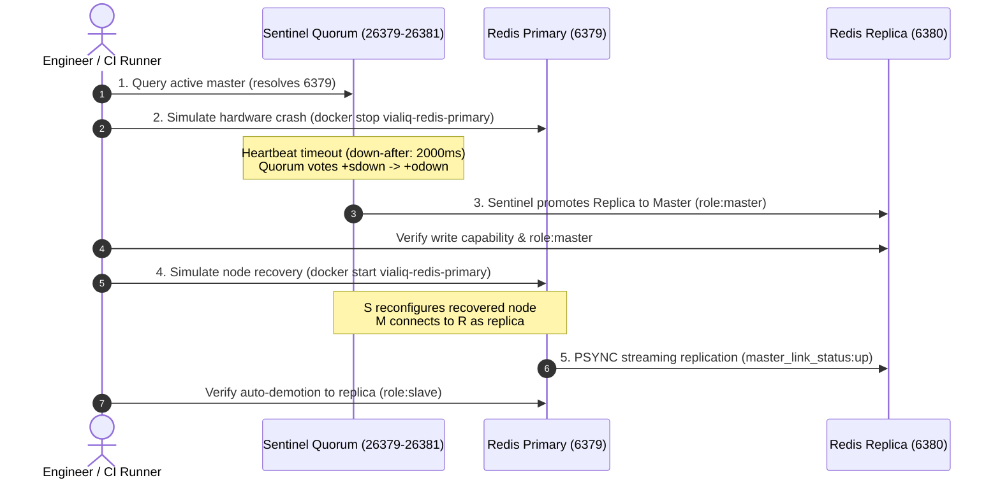

# EDC Infrastructure, High-Availability & Resilience Playbook

This skill captures the operational workflows, diagnostic procedures, and architectural guardrails for running and verifying the distributed database and caching infrastructure of the Vialiq EDC platform.

---

## 1. Architecture & Port Allocation Matrix

The local development environment mirrors multi-tier production boundaries using isolated Docker containers:

| Service | Port | Replica Set / Role | Bridge Network | Purpose |
| :--- | :--- | :--- | :--- | :--- |
| **Layer 1 Admin Mongo** | `27017` | `rs-admin` (Primary) | `vialiq-mongo-admin-net` | Control plane / Cluster 0 (Tenants, users, zero clinical data) |
| **Layer 2 Dev Mongo** | `27027` | `rs-dev` (Primary) | `vialiq-mongo-dev-net` | Not-live clinical study databases (Dev/UAT sandboxes) |
| **Layer 3 Prod Mongo** | `27037` | `rs-prod` (Primary) | `vialiq-mongo-prod-net` | Live GxP study databases (Production clinical trials) |
| **Redis Primary** | `6379` | Master (Writes) | `vialiq-dev-net` (via `redis-net`) | Distributed locks, cache invalidation, SignalR backplane |
| **Redis Replica** | `6380` | Replica (Auto-promote) | `vialiq-dev-net` (via `redis-net`) | Streaming async replication (`PSYNC`), standby master |
| **Redis Sentinel 1** | `26379` | Quorum = 2 | `vialiq-dev-net` (via `redis-net`) | Quorum monitoring, failure detection (`down-after: 2000ms`) |
| **Redis Sentinel 2** | `26380` | Quorum = 2 | `vialiq-dev-net` (via `redis-net`) | Leader election, failover coordinator |
| **Redis Sentinel 3** | `26381` | Quorum = 2 | `vialiq-dev-net` (via `redis-net`) | Split-brain tiebreaker |
| **Redis Dev (Fallback)**| `6379` | Standalone Single-Node | `vialiq-dev-net` | Minimal fallback for low-resource environments |

> [!NOTE]
> All Redis containers attach to `redis-net` via `network_mode: "service:redis-net"` to share a unified network namespace, advertising `127.0.0.1` so host .NET clients and test runners connect transparently.

---

## 2. Standard Operational Commands

All infrastructure actions are orchestrated via standard npm scripts in `package.json`:

### Lifecycle Management
```bash
# 1. Start full default HA infrastructure (MongoDB 3-layer + Redis Sentinel HA)
npm run dev:infra

# 2. Check complete environment health across all 8 endpoints
npm run dev:doctor

# 3. View status of all infrastructure containers
npm run dev:infra:status

# 4. Gracefully tear down all infrastructure (downs both HA and standalone Redis)
npm run dev:infra:down

# 5. Clean wipe (purges all named volumes and data directories with -v)
npm run dev:infra:clean

# 6. Start lightweight standalone Redis fallback (single container on 6379)
npm run dev:infra:standalone
```

---

## 3. Automated Verification Gate (Infra-TDD)

> [!IMPORTANT]
> **Mandatory Infra-TDD Rule**: Never declare an infrastructure change or PR complete without executing the 24-point automated validation harness.

```bash
npm run test:infra
# (or: node tools/scripts/test-docker-infra.mjs)
```

### The 24-Point Harness Coverage Checklist

1. **MongoDB 3-Layer Architecture (Suite 1)**:
   - [x] TCP Connectivity: Ports `27017`, `27027`, `27037` reachable.
   - [x] Primary Election: Assert `db.hello().isWritablePrimary === true` on all 3 layers.
   - [x] ACID Transactions: Multi-document commit and rollback across 2 collections inside a session.
   - [x] Network Isolation: Negative routing test verifying Layer 2 Dev cannot reach Layer 1 Admin or Layer 3 Prod.
   - [x] Initializer Exit: Assert all `vialiq-init-*` containers exited cleanly with code `0`.

2. **Redis Server, Security & GxP Cache Policy (Suite 2)**:
   - [x] TCP Connectivity: Active master reachable.
   - [x] NOAUTH Rejection: Unauthenticated `PING` returns `NOAUTH`.
   - [x] Authenticated Access: `PING` with valid credentials returns `PONG`.
   - [x] Fast-Path Edit Lease Simulation: Atomic `SET NX EX`, `GET`, and `DEL` on active master.
   - [x] GxP Invariant: Assert `maxmemory-policy volatile-lru` (prevents eviction of invariant dictionaries and locks).
   - [x] Disaster Recovery: Assert `appendonly yes` (AOF streaming active).
   - [x] Blueprint Audit: Static audit of `tools/docker/redis-prod.conf` (`bind 127.0.0.1 -::1`, `protected-mode yes`, `no-appendfsync-on-rewrite no`).

3. **Redis Sentinel HA & Dynamic Topology (Suite 3)**:
   - [x] Control Auth: Ports `26379`, `26380`, `26381` require password (`NOAUTH` enforced).
   - [x] Quorum Master Discovery: `sentinel get-master-addr-by-name mymaster` dynamically resolves active master.
   - [x] Config Persistence: `/etc/redis/sentinel.conf` verified on persistent named volumes.

---

## 4. Automated Chaos Failover Drill

To test automated master crash, secondary promotion, and self-healing recovery:

```bash
npm run docker:redis:test-failover
# (or: bash tools/scripts/test-redis-ha-failover.sh)
```

### Drill Execution Lifecycle:


> [!TIP]
> The drill script uses a `trap cleanup EXIT INT TERM` handler to ensure that even if the drill is interrupted or cancelled, the stopped master is automatically restarted to prevent degraded cluster states.

---

## 5. Architectural Guardrails & Common Gotchas

### Gotcha 1: Architecture Bias (`platform:`)
- **Problem**: Hardcoding `platform: linux/arm64` causes x86-64 Linux CI runners and Windows developers to fail with `exec format error`.
- **Rule**: Never specify `platform:` in Compose files. Standard multi-arch images automatically negotiate native execution on ARM64 and x86-64.

### Gotcha 2: Liveness vs. Readiness (Primary Election Race)
- **Problem**: MongoDB responds to raw TCP ping and returns code `0` while still in `STARTUP2` or conducting primary election. Initializers or apps connecting immediately fail with `NotWritablePrimary`.
- **Rule**: Always gate MongoDB healthchecks on `db.hello().isWritablePrimary || quit(1)`. Initializers must poll `isWritablePrimary` in a confirmation loop before creating completion markers.

### Gotcha 3: Dynamic State Persistence (Sentinel Anti-Amnesia)
- **Problem**: Sentinels rewrite their own configuration file upon failover. Generating `/tmp/sentinel.conf` unconditionally on boot wipes failover state on container restarts, reverting clusters to stale masters and risking split-brain.
- **Rule**:
  1. Mount Sentinel configuration in persistent named volumes (`sentinel_data:/etc/redis`).
  2. Conditionally generate configs: `if [ ! -f /etc/redis/sentinel.conf ]; then ...; fi`.

### Gotcha 4: Secret Handling & Shell Escaping
- **Problem**: Substituting `${PASSWORD}` into `sh -c "echo 'requirepass ${PASSWORD}'"` breaks when passwords contain single quotes (`'`) or shell syntax, and YAML folded scalars (`command: >`) merge unquoted arguments with spaces.
- **Rule**:
  1. Pass credentials via Docker's binary environment table (`environment: [SENTINEL_PORT, VIALIQ_REDIS_PASSWORD]`).
  2. Use `$$` Compose escaping so `$VAR` is evaluated strictly inside the container.
  3. Escape `\` to `\\` and `"` to `\"` inside the container using `sed` and `printf`.
  4. Use exec-form JSON arrays for daemon command lines (`["redis-server", "--requirepass", "${PASSWORD:-...}"]`).

### Gotcha 5: Sentinel CLI Arguments Restriction
- **Problem**: Passing `--sentinel monitor mymaster 127.0.0.1 6379 2` via CLI arguments when `sentinel.conf` already exists causes Redis Sentinel to crash fatally on reboot:
  `FATAL CONFIG FILE ERROR: Duplicate master name.`
- **Rule**: Never pass `sentinel monitor` as a CLI argument on restart. Generate it once in `sentinel.conf` on initial boot and allow Sentinel to manage it thereafter.

### Gotcha 6: GxP Crash Durability
- **Problem**: In clinical trial software (FDA 21 CFR Part 11, GAMP 5), micro-latency optimizations cannot compromise crash durability.
- **Rule**:
  - `appendonly yes` must be active on both primary and replica.
  - Set `no-appendfsync-on-rewrite no` (guarantees $\le 1$s crash durability even during background AOF rewrites).
  - Set `maxmemory-policy volatile-lru` so un-expiring clinical dictionaries and lease locks cannot be silently evicted.

---

## 6. Extensibility Roadmap: Adding New Components

As the platform evolves, extend this skill following these patterns:

1. **Adding Keycloak (Identity Plane — Tier 1 & Tier 2)**:
   - Add Keycloak service attached to `vialiq-dev-net`.
   - Gate healthchecks on `/health/ready` (not `/health/live`).
   - Add automated realm export/import testing to `test-docker-infra.mjs`.

2. **Adding PostgreSQL / Data Connect (Relational Data Plane)**:
   - Mount persistent volume to `/var/lib/postgresql/data`.
   - Gate healthchecks on `pg_isready -U <user> -d <db>`.
   - Add migration rollback drills into the test harness.

3. **CI/CD Integration**:
   - In GitHub Actions (`.github/workflows/infra-test.yml`), run `npm run dev:infra` followed by `npm run test:infra` on Ubuntu x86 runners to guarantee continuous cross-platform regression prevention.
