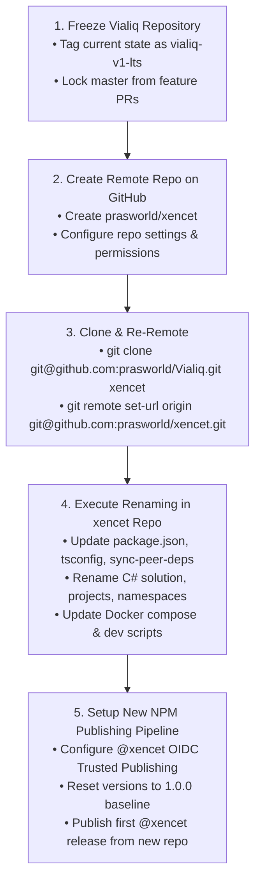
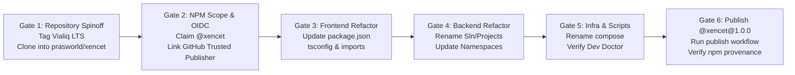

# Vialiq to Xencet Platform Rebrand, NPM Package Publishing & Infrastructure Migration Guide

> **Document ID:** `XC-DEP-003` (Formerly `VIALIQ-DEP-003`)  
> **Domain:** Platform Engineering, Monorepo DevOps, Cloud Ingress & GxP Regulatory Compliance  
> **Target Rebrand:** `Vialiq` $\longrightarrow$ `Xencet`  
> **Strategy:** Clone/Fork Succession Model (Vialiq Frozen $\longrightarrow$ Xencet Active)  
> **Target Domain:** `xencet.com`  
> **Target NPM Scope:** `@xencet`  
> **Target Custom Element Prefix:** `<xc-*>` (with `<vi-*>` backward-compatibility alias)  
> **Compliance Standards:** FDA 21 CFR Part 11 §11.10(e), ICH GCP E6(R3) Section 5.5.3, ISO 27001, SOC 2 Type II  

---

## 1. Executive Summary & Migration Invariants

This guide serves as the authoritative, comprehensive blueprint to transition the platform product, published npm packages, backend .NET services, container topologies, and cloud ingress routing from **Vialiq** to **Xencet**.

```
                           PRODUCT SUCCESSION ARCHITECTURE (CLONE/FORK MODEL)
                                                  │
         ┌────────────────────────────────────────┴────────────────────────────────────────┐
         ▼                                                                                 ▼
CURRENT REPOSITORY: prasworld/Vialiq                             SPUN-OFF REPOSITORY: prasworld/xencet
------------------------------------                             -------------------------------------
• Status: FROZEN / MAINTENANCE-ONLY                              • Status: ACTIVE NEXT-GENERATION PRODUCT
• Zero in-place renames; code remains untouched                  • Cloned/forked from Vialiq baseline
• Retains existing @vialiq/* packages                            • Renamed to @xencet/*, Xencet.Api, xencet.com
• Continues running active legacy studies                        • New NPM publishing pipeline (OIDC @ 1.0.0)
• Archived & deprecated when studies conclude                    • All future development & features happen here
```

### The 4 Non-Negotiable Invariants:
1. **Preservation of Existing Vialiq Repository:** We will **NOT** rename everything in this current repository. Vialiq will cease to receive new feature changes and will remain frozen in its current working state until eventual deprecation, guaranteeing zero disruption or regressions for active studies.
2. **Dedicated Clone/Fork for Xencet:** Xencet will be initialized in a dedicated repository (`prasworld/xencet`). All renaming, new npm publishing pipelines, namespace refactorings, and infrastructure updates will be executed exclusively inside the new repository.
3. **FDA 21 CFR Part 11 Audit Trail Immutability:** Pre-existing audit records signed with system identifier `vialiq-api` must remain cryptographically verifiable and uncorrupted. Database records must **never** be mass-updated via raw database scripts.
4. **Clean NPM Version Baseline:** Published packages under `@xencet/*` in the new repository start at a clean enterprise baseline **`1.0.0`** with independent OIDC Trusted Publishing and isolated Git release tags.

---

## 2. Product Succession Architecture: The Clone/Fork Model

### 2.1 Why In-Place Renaming in this Repository is Prohibited

Renaming the product in-place inside `prasworld/Vialiq` carries significant unnecessary risk:
1. **Clinical Regulatory Risk (GxP / CSV):** Active clinical trials currently validated on Vialiq would require extensive re-validation, protocol amendments, and audit trail reconciliation if the existing codebase were modified in-place.
2. **Git & Tag Namespace Pollution:** Monorepo git tags (`flux-ui@0.28.1`, `web-components@0.37.3`) would collide or create ambiguous versioning histories with new `@xencet/*` package versions.
3. **CI/CD Complexity:** Attempting to publish dual packages (`@vialiq/*` and `@xencet/*`) from a single repository complicates `.github/workflows/publish.yml` with dual OIDC tokens and complex conditional triggers.

### 2.2 The Two-Repository Lifecycle

| Dimension | `prasworld/Vialiq` (Current Repo) | `prasworld/xencet` (New Spun-off Repo) |
|---|---|---|
| **Role** | Legacy Platform / LTS Maintenance | Active Commercial Product |
| **Commit Activity** | **Frozen** (Only emergency security hotfixes) | **Active** (All new features, bugfixes, releases) |
| **NPM Scope** | `@vialiq/*` (Preserved in current state) | `@xencet/*` (Published starting at `1.0.0`) |
| **Backend API** | `Vialiq.Api` | `Xencet.Api` |
| **Domain** | `vialiq.com` | `xencet.com` |
| **End of Life** | Archived when remaining studies conclude | Ongoing commercial lifecycle |

### 2.3 Spinoff & Initialization Workflow



#### Step-by-Step Spinoff Commands:
```bash
# 1. Snapshot current Vialiq repository
git tag -a vialiq-v1-lts -m "Tagging final baseline of Vialiq platform before Xencet spinoff"
git push origin refs/tags/vialiq-v1-lts

# 2. Clone Vialiq into a fresh directory for Xencet
cd ..
git clone git@github.com:prasworld/Vialiq.git xencet
cd xencet

# 3. Point remote to the new Xencet GitHub repository
git remote set-url origin git@github.com:prasworld/xencet.git

# 4. Verify remote
git remote -v
# origin  git@github.com:prasworld/xencet.git (fetch)
# origin  git@github.com:prasworld/xencet.git (push)
```

---

## 3. External Platform Configurations: npmjs.com & GitHub

The new repository (`prasworld/xencet`) will establish independent OIDC Trusted Publishing with npmjs.com for the `@xencet` organization.

```
┌─────────────────────────────────┐               OIDC Token (id-token: write)               ┌─────────────────────────────────┐
│         GitHub Actions          │ ────────────────────────────────────────────────────────► │           npmjs.com             │
│    repo: prasworld/xencet       │                                                           │       scope: @xencet            │
│ workflow: .github/publish.yml   │ ◄──────────────────────────────────────────────────────── │   Trusted Publisher Verified    │
│      branch: master             │             Provenance Attestation Published              └─────────────────────────────────┘
└─────────────────────────────────┘
```

### 3.1 Configuration on `npmjs.com`

1. **Create the `@xencet` Organization Scope:**
   - Log into [npmjs.com](https://www.npmjs.com) with the platform admin account.
   - Click profile icon $\rightarrow$ **Add Organization** $\rightarrow$ Name: **`xencet`**.
   - Set the organization's default package visibility to **Public**.
2. **Configure Keyless OIDC Trusted Publishing:**
   - In the `@xencet` organization settings:
     - Navigate to **Settings** $\rightarrow$ **Trusted Publishers** $\rightarrow$ **Add Trusted Publisher**.
     - Select **GitHub**.
     - **GitHub Organization / User:** `prasworld`.
     - **Repository:** `xencet`.
     - **Workflow filename:** `publish.yml`.
     - **Environment:** *(Leave blank for master branch default)*.
   - *Result:* The new repository publishes `@xencet/*` packages with full public provenance attestation without storing permanent static API secrets.
3. **Alternative: Classic NPM Automation Token:**
   - If organization-level OIDC is pending verification on npmjs:
     - Generate an **Automation Access Token** under `@xencet`.
     - In GitHub repo `prasworld/xencet` $\rightarrow$ **Settings** $\rightarrow$ **Secrets and variables** $\rightarrow$ **Actions** $\rightarrow$ Add secret `NPM_TOKEN`.

### 3.2 Configuration on GitHub (`github.com/prasworld/xencet`)

1. **Create the New Repository:**
   - On GitHub, create a new empty repository: `prasworld/xencet` (Public or Private depending on company policy).
2. **Workflow Permissions:**  
   Ensure the new repository inherits workflow permissions in `.github/workflows/publish.yml`:
   ```yaml
   permissions:
     contents: write   # Allows pushing annotated git tags
     id-token: write   # Allows npm OIDC provenance attestation
   ```
3. **Preserve `prasworld/Vialiq`:**  
   The existing `prasworld/Vialiq` repository remains active and unchanged on GitHub until all active studies complete, at which point it is marked as **Archived (Read-Only)**.

---

## 4. Frontend Monorepo & NPM Packages Migration (In `xencet` Repo)

All transformations detailed below are executed exclusively in the new `xencet` repository.

### 4.1 Inventory of Monorepo Libraries

| Nx Project | Legacy npm Name | Target npm Name (in `xencet` repo) | Initial Version | Publish Status |
|---|---|---|---|---|
| `web-components` | `@vialiq/web-components` | `@xencet/web-components` | **`1.0.0`** | Public |
| `flux-ui` | `@vialiq/flux-ui` | `@xencet/flux-ui` | **`1.0.0`** | Public |
| `icons` | `@vialiq/icons` | `@xencet/icons` | **`1.0.0`** | Public |
| `state-fp` | `@vialiq/state-fp` | `@xencet/state-fp` | **`1.0.0`** | Public |
| `automapper` | `@vialiq/automapper` | `@xencet/automapper` | **`1.0.0`** | Public |
| `form-builder` | `@vialiq/form-builder` | `@xencet/form-builder` | **`1.0.0`** | Internal (`private: true`) |
| `form-renderer` | `@vialiq/form-renderer` | `@xencet/form-renderer` | **`1.0.0`** | Internal (`private: true`) |
| `utilities` | `@vialiq/utilities` | `@xencet/utilities` | **`1.0.0`** | Internal (`private: true`) |

### 4.2 Manifest Updates (`package.json`)

1. **Publishable Libraries (`libs/{lib}/package.json`):**
   ```json
   {
     "name": "@xencet/web-components",
     "version": "1.0.0",
     "publishConfig": {
       "access": "public"
     },
     "repository": {
       "type": "git",
       "url": "https://github.com/prasworld/xencet.git"
     }
   }
   ```
2. **Internal Libraries (`form-builder`, `form-renderer`, `utilities`):**
   Explicitly mark as private:
   ```json
   {
     "name": "@xencet/form-builder",
     "version": "1.0.0",
     "private": true
   }
   ```
3. **Root `package.json`:**
   ```json
   {
     "name": "@xencet/workspace",
     "dependencies": {
       "@xencet/icons": "1.0.0",
       "@xencet/web-components": "^1.0.0",
       "@xencet/flux-ui": "1.0.0"
     },
     "overrides": {
       "@xencet/web-components": {
         "@xencet/icons": "$@xencet/icons",
         "@xencet/flux-ui": "$@xencet/flux-ui"
       }
     }
   }
   ```

### 4.3 TypeScript Base Path Mappings (`tsconfig.base.json`)

Update all path aliases to `@xencet/*`:

```json
{
  "compilerOptions": {
    "paths": {
      "@xencet/flux-ui": ["libs/flux-ui/src/index.ts"],
      "@xencet/flux-ui/styles": ["libs/flux-ui/src/styles/index.scss"],
      "@xencet/flux-ui/tokens": ["libs/flux-ui/src/tokens/index.ts"],
      "@xencet/automapper": ["libs/automapper/src/index.ts"],
      "@xencet/automapper/*": ["libs/automapper/src/*"],
      "@xencet/state-fp": ["libs/state-fp/src/index.ts"],
      "@xencet/state-fp/*": ["libs/state-fp/src/*"],
      "@xencet/form-builder": ["libs/form-builder/src/index.ts"],
      "@xencet/form-renderer": ["libs/form-renderer/src/index.ts"],
      "@xencet/utilities": ["libs/utilities/src/index.ts"],
      "@xencet/icons": ["libs/icons/src/index.ts"],
      "@xencet/icons/*": ["libs/icons/src/*"],
      "@xencet/web-components": ["libs/web-components/src/index.ts"],
      "@xencet/web-components/*": ["libs/web-components/src/*"]
    }
  }
}
```

### 4.4 Peer Dependency Sync Script (`tools/scripts/sync-peer-deps.mjs`)

Update the script to scan for `@xencet/` dependencies:

```javascript
if (distPkg.peerDependencies) {
  for (const dep of Object.keys(distPkg.peerDependencies)) {
    if (!dep.startsWith('@xencet/')) continue;
    
    const libName = dep.replace('@xencet/', '');
    const localPath = join(workspaceRoot, 'libs', libName, 'package.json');
    // ...
```

### 4.5 Source Code Import Statements

Global search-and-replace across `apps/` and `libs/`:
* `from '@vialiq/'` $\longrightarrow$ `from '@xencet/'`
* `import '@vialiq/'` $\longrightarrow$ `import '@xencet/'`

### 4.6 Custom Element Aliasing: Transitioning to `<xc-*>`

In `libs/web-components`, register elements under `<xc-*>` while preserving `<vi-*>` as an alias for backward compatibility:

```typescript
// libs/web-components/src/base/registration.ts
export function registerCustomElement(tagName: string, elementClass: CustomElementConstructor): void {
  const primaryTag = tagName.startsWith('vi-') ? tagName.replace(/^vi-/, 'xc-') : tagName;
  const legacyTag = tagName.startsWith('xc-') ? tagName.replace(/^xc-/, 'vi-') : tagName;

  // 1. Primary Registration (<xc-button>)
  if (!customElements.get(primaryTag)) {
    customElements.define(primaryTag, elementClass);
  }

  // 2. Backward Compatibility Alias (<vi-button>)
  if (!customElements.get(legacyTag)) {
    customElements.define(legacyTag, class extends elementClass {
      connectedCallback() {
        if (process.env.NODE_ENV !== 'production') {
          console.warn(`[Xencet] <${legacyTag}> is deprecated. Please use <${primaryTag}>.`);
        }
        super.connectedCallback?.();
      }
    });
  }
}
```

### 4.7 Bundlers & SCSS Importers

* **Webpack Custom Importer (`apps/edc/remote1/webpack.config.ts`):**
  ```typescript
  if (url.startsWith('@xencet/')) {
    const cleanUrl = url.replace('@xencet/', '');
    // Resolve to local workspace source
  }
  ```
* **Vite SCSS Aliasing (`libs/web-components/vite.config.ts`):**
  ```typescript
  resolve: {
    alias: [
      { find: /^@xencet\/(.*)/, replacement: path.resolve(__dirname, '../$1/src') }
    ]
  }
  ```

---

## 5. Backend .NET 9 API & Services Migration (In `xencet` Repo)

### 5.1 Solution & Project Renaming (`backend/api/`)

Rename project files and their directory folders:
* `Vialiq.Api.sln` $\longrightarrow$ `Xencet.Api.sln`
* `src/Vialiq.Api/Vialiq.Api.csproj` $\longrightarrow$ `src/Xencet.Api/Xencet.Api.csproj`
* `src/Vialiq.Core/Vialiq.Core.csproj` $\longrightarrow$ `src/Xencet.Core/Xencet.Core.csproj`
* `src/Vialiq.Domain/Vialiq.Domain.csproj` $\longrightarrow$ `src/Xencet.Domain/Xencet.Domain.csproj`
* `src/Vialiq.Infrastructure/Vialiq.Infrastructure.csproj` $\longrightarrow$ `src/Xencet.Infrastructure/Xencet.Infrastructure.csproj`
* `src/Vialiq.Caching/Vialiq.Caching.csproj` $\longrightarrow$ `src/Xencet.Caching/Xencet.Caching.csproj`
* `src/Vialiq.Validation/Vialiq.Validation.csproj` $\longrightarrow$ `src/Xencet.Validation/Xencet.Validation.csproj`
* `tests/Vialiq.Caching.Tests/` $\longrightarrow$ `tests/Xencet.Caching.Tests/`
* `tests/Vialiq.Api.Tests/` $\longrightarrow$ `tests/Xencet.Api.Tests/`
* `tests/Vialiq.Validation.Tests/` $\longrightarrow$ `tests/Xencet.Validation.Tests/`

### 5.2 C# Code & Namespace Refactoring

Global find-and-replace across all `.cs` files:
* `namespace Vialiq.` $\longrightarrow$ `namespace Xencet.`
* `using Vialiq.` $\longrightarrow$ `using Xencet.`

### 5.3 Unauthenticated Host Discovery (`TenantDiscoveryService.cs`)

Update domain boundaries and RFC 1123 regex matching:

```csharp
public sealed class TenantDiscoveryService : ITenantDiscoveryService
{
    private const string ApexDomain = "xencet.com";
    private const string DomainSuffix = ".xencet.com";
    private readonly IStudyRoutingRegistry _registry;

    public TenantDiscoveryService(IStudyRoutingRegistry registry)
    {
        _registry = registry;
    }
    
    public async Task<TenantDiscoveryResult> DiscoverTenantByHostAsync(string host)
    {
        if (string.IsNullOrWhiteSpace(host))
        {
            return TenantDiscoveryResult.NotFound("Empty or missing host header.");
        }

        // Normalize host: strip port if present, trim whitespace, convert to lowercase
        var normalizedHost = host.Split(':')[0].Trim().ToLowerInvariant();

        // 1. Apex Domain / Platform Portal (xencet.com / www.xencet.com)
        // MUST be handled before slicing: "xencet.com".Length (10) < ".xencet.com".Length (11)
        if (normalizedHost == ApexDomain || normalizedHost == $"www.{ApexDomain}")
        {
            return TenantDiscoveryResult.GlobalSaaS();
        }

        // 2. Xencet Subdomain Routing (*.xencet.com)
        // Guard against ArgumentOutOfRangeException: verify length strictly exceeds suffix
        if (normalizedHost.Length > DomainSuffix.Length && 
            normalizedHost.EndsWith(DomainSuffix, StringComparison.OrdinalIgnoreCase))
        {
            var prefix = normalizedHost[..^DomainSuffix.Length];
            var tenantSlug = ExtractTenantSlug(prefix);
            return await _registry.ResolveTenantBySlugAsync(tenantSlug);
        }

        // 3. Custom Client Vanity Domains (e.g. edc.novartis.com)
        return await ResolveVanityDomainAsync(normalizedHost);
    }
}
```

### 5.4 App Configuration & Messaging (`appsettings.json`)

Update connection namespaces and prefixes:
* **Redis Instance Prefix:** `"Redis:InstanceName": "Xencet:"`
* **CORS Policies:**
  ```json
  "Cors": {
    "AllowedOrigins": [
      "https://*.xencet.com",
      "https://xencet.com"
    ]
  }
  ```
* **RabbitMQ Message Bus:**
  * Exchange: `xencet.clinical.events`
  * Queues: `xencet.audit.stream`, `xencet.csfle.cdc`
* **JWT Issuer Validation:**
  ```csharp
  ValidIssuers = new[] { "https://api.xencet.com" },
  ValidAudiences = new[] { "https://api.xencet.com" }
  ```

---

## 6. Docker Infrastructure & Local Development (In `xencet` Repo)

### 6.1 Docker Compose Topologies (`tools/docker/`)

1. **MongoDB Cluster (`tools/docker/docker-compose.3layer.yml`):**
   * Container names:
     * `vialiq-mongo-layer1-admin` $\longrightarrow$ `xencet-mongo-layer1-admin`
     * `vialiq-mongo-layer2-dev` $\longrightarrow$ `xencet-mongo-layer2-dev`
     * `vialiq-mongo-layer3-prod` $\longrightarrow$ `xencet-mongo-layer3-prod`
   * Network: `vialiq-3layer-net` $\longrightarrow$ `xencet-3layer-net`
   * Named Volumes: `xencet_mongo_admin_data`, `xencet_mongo_dev_data`, `xencet_mongo_prod_data`
2. **Redis High-Availability Cluster (`tools/docker/docker-compose.redis-dev.yml`):**
   * Container names:
     * `vialiq-redis-primary` $\longrightarrow$ `xencet-redis-primary`
     * `vialiq-redis-replica` $\longrightarrow$ `xencet-redis-replica`
     * `vialiq-sentinel-1..3` $\longrightarrow$ `xencet-sentinel-1..3`
   * Network: `xencet-dev-net`

### 6.2 Dev Scripts & Package Commands (`package.json`)

Update npm script shortcuts:
```json
{
  "scripts": {
    "dev:api": "dotnet watch --project backend/api/src/Xencet.Api",
    "docker:mongo:status": "docker ps --filter 'name=xencet-mongo'",
    "docker:redis:status": "docker ps --filter 'name=xencet-redis' --filter 'name=xencet-sentinel'",
    "docker:redis:test-failover": "bash tools/scripts/test-redis-ha-failover.sh",
    "api:build": "dotnet build backend/api/Xencet.Api.sln",
    "api:watch": "dotnet watch --project backend/api/src/Xencet.Api",
    "api:test": "dotnet test backend/api/Xencet.Api.sln"
  }
}
```

Update references in helper scripts:
* `tools/scripts/dev-doctor.mjs`: Display `XENCET EDC — LOCAL DEVELOPMENT ENVIRONMENT DOCTOR`.
* `tools/scripts/test-redis-ha-failover.sh`: Point to `xencet-redis-primary` and `xencet-redis-replica`.

---

## 7. Cloud Ingress, TLS Certificates & Custom Domains

### 7.1 DNS Zone Provisioning (`xencet.com`)

In Route 53 or Cloudflare:
```dns
xencet.com.         A      <GLB_ANYCAST_IP>
*.xencet.com.       CNAME  ingress.xencet.com.
api.xencet.com.     CNAME  ingress.xencet.com.
assets.xencet.com.  CNAME  cdn.xencet.com.
```

### 7.2 Wildcard TLS/SSL Certificate

Provision `*.xencet.com` via Kubernetes `cert-manager`:
```yaml
apiVersion: cert-manager.io/v1
kind: Certificate
metadata:
  name: xencet-wildcard-cert
  namespace: ingress-system
spec:
  secretName: xencet-wildcard-tls
  dnsNames:
    - "xencet.com"
    - "*.xencet.com"
  issuerRef:
    name: letsencrypt-dns01-prod
    kind: ClusterIssuer
```

### 7.3 Kubernetes Ingress Setup

Ingress routes all traffic for `*.xencet.com`:
```yaml
apiVersion: networking.k8s.io/v1
kind: Ingress
metadata:
  name: xencet-ingress-router
spec:
  tls:
    - hosts: ["*.xencet.com", "xencet.com"]
      secretName: xencet-wildcard-tls
  rules:
    - host: "*.xencet.com"
      http:
        paths:
          - path: /
            pathType: Prefix
            backend:
              service:
                name: xencet-api-service
                port: { number: 80 }
```

### 7.4 Sponsor IdP Whitelisting (Okta / Azure AD)

Configure sponsor SSO applications:
* Register redirect URI: `https://{tenant}.xencet.com/auth/callback`.

---

## 8. FDA 21 CFR Part 11 & GxP Regulatory Compliance

### 8.1 Audit Trail Hash Verifiability Invariant

Under **FDA 21 CFR Part 11 §11.10(e)** and **ICH GCP E6(R3)**:
* Computer-generated, time-stamped audit trails must be **immutable**.
* In `Xencet`, all newly created audit trails record `SystemId: "xencet-api"`.
* If a study database is migrated from Vialiq to Xencet, historical audit records with `SystemId: "vialiq-api"` must **never** be rewritten via database scripts. The Xencet audit verification engine honors historical `vialiq-api` signatures natively.

### 8.2 Computer System Validation (CSV) Documentation

Under ICH GCP Section 5.5.3:
1. File formal **System Validation Package for Xencet EDC** (`SVP-XC-001`).
2. Establish User Requirements Specification (URS), System Architecture Specification (SAS), and Requirements Traceability Matrix (RTM) for the Xencet product line.
3. Archive electronically signed verification test logs in the Xencet regulatory validation binder.

---

## 9. Step-by-Step Spinoff & Verification Checklist



### Phase A: Repository Spinoff & External Setup
- [ ] Tag `prasworld/Vialiq` with `vialiq-v1-lts` to seal its final baseline.
- [ ] Create new GitHub repository `prasworld/xencet`.
- [ ] Clone `Vialiq` locally and point origin to `prasworld/xencet`.
- [ ] Claim organization `@xencet` on [npmjs.com](https://www.npmjs.com) with Public default access.
- [ ] Configure GitHub Actions as Trusted Publisher under `@xencet` on npmjs.
- [ ] Provision DNS zone and wildcard TLS certificate for `*.xencet.com`.

### Phase B: Frontend Monorepo Updates (in `xencet` repo)
- [ ] Update `libs/*/package.json` package names to `@xencet/*` and versions to `1.0.0`.
- [ ] Mark internal libraries (`form-builder`, `form-renderer`, `utilities`) as `"private": true`.
- [ ] Update root `package.json` to `@xencet/workspace` and `@xencet/*` dependencies.
- [ ] Update `tsconfig.base.json` path mappings.
- [ ] Update `tools/scripts/sync-peer-deps.mjs`.
- [ ] Replace `from '@vialiq/'` with `from '@xencet/'` across `apps/` and `libs/`.
- [ ] Register `<xc-*>` tags with `<vi-*>` aliasing in `web-components`.
- [ ] **Verification Command:** `npx nx run-many -t build --all` (Must pass with 0 errors).

### Phase C: Backend .NET Updates (in `xencet` repo)
- [ ] Rename solution and project files under `backend/api/` from `Vialiq.*` to `Xencet.*`.
- [ ] Global find-and-replace `namespace Vialiq.` $\rightarrow$ `namespace Xencet.` and `using Vialiq.` $\rightarrow$ `using Xencet.`.
- [ ] Update `TenantDiscoveryService.cs` domain boundaries to `xencet.com`.
- [ ] Update `appsettings.json` Redis instance name to `Xencet:`.
- [ ] **Verification Command:** `dotnet build backend/api/Xencet.Api.sln` (Must compile with 0 errors).
- [ ] **Verification Command:** `dotnet test backend/api/Xencet.Api.sln` (All unit tests pass).

### Phase D: Docker & Dev Scripts (in `xencet` repo)
- [ ] Update container and network names in `tools/docker/docker-compose.3layer.yml` and `docker-compose.redis-dev.yml`.
- [ ] Update npm scripts in root `package.json`.
- [ ] **Verification Command:** `npm run dev:infra && npm run dev:doctor` (All services healthy).

### Phase E: Initial Publish & CI/CD Validation
- [ ] Commit all changes to `master` in `prasworld/xencet`.
- [ ] Trigger `.github/workflows/publish.yml` on `prasworld/xencet`.
- [ ] Verify `@xencet/web-components`, `@xencet/flux-ui`, `@xencet/icons`, `@xencet/state-fp`, and `@xencet/automapper` publish cleanly at `1.0.0` with verified OIDC provenance on npmjs.com.

---

## 10. Vialiq Sunset & Deprecation Roadmap

```
TODAY                      6 TO 12 MONTHS LATER                     SUNSET MILESTONE
  │                                  │                                      │
  ▼                                  ▼                                      ▼
Freeze Vialiq              Active Vialiq Studies                  All Studies Concluded
• No new feature PRs       Conclude / Migrate                     • Archive GitHub Repo
• Spinoff Xencet           • Run in maintenance mode              • npm deprecate @vialiq/*
• Xencet is active         • Security hotfixes only               • Decommission DNS
```

1. **Immediate Freeze:**  
   The `prasworld/Vialiq` repository is frozen. No feature development occurs here. It serves exclusively as the LTS maintenance baseline for active clinical trials.
2. **Maintenance Period:**  
   As active clinical trials running on Vialiq reach study closure (LPLV - Last Patient Last Visit, database lock, and clinical study report submission), no new studies are initiated on Vialiq. All new clinical trial protocols are onboarded directly to Xencet.
3. **Formal Deprecation & Archival:**  
   Once the last study on Vialiq completes:
   * GitHub repository `prasworld/Vialiq` is changed to **Archived (Read-Only)**.
   * Deprecation notices are issued on npm:
     ```bash
     npm deprecate @vialiq/web-components "Vialiq EDC has reached end-of-life. Please migrate to @xencet/web-components."
     npm deprecate @vialiq/flux-ui "Vialiq EDC has reached end-of-life. Please migrate to @xencet/flux-ui."
     npm deprecate @vialiq/icons "Vialiq EDC has reached end-of-life. Please migrate to @xencet/icons."
     npm deprecate @vialiq/state-fp "Vialiq EDC has reached end-of-life. Please migrate to @xencet/state-fp."
     npm deprecate @vialiq/automapper "Vialiq EDC has reached end-of-life. Please migrate to @xencet/automapper."
     ```

---

## 11. Multi-Product Xencet Suite Target Architecture (Discussion Baseline)

When Xencet evolves beyond EDC into a unified Life Sciences Suite (**EDC**, **eTMF**, **Safety/PV**, **CTMS**, **eConsent**, backed by shared **Platform Admin & Identity**), the target workspace architecture follows these design agreements (without altering `libs/`, `backend/api/`, or renaming `Vialiq` $\rightarrow$ `Xencet` before the Phase-1 spinoff):

### 11.1 Proposed Suite Taxonomy & Phased Workspace Structure
```
xencet/
├── apps/
│   ├── shell/                         # Unified Suite Host Shell (Module Federation)
│   ├── edc/
│   │   └── remote1/                   # EDC Federated Remotes / Product Modules
│   ├── etmf/                          # (Deferred until eTMF kickoff)
│   ├── safety/                        # (Deferred until Safety/PV kickoff)
│   ├── ctms/                          # (Deferred until CTMS kickoff)
│   ├── econsent/                      # Lightweight Standalone Patient Portal (eConsent / ePRO)
│   └── platform/                      # Platform Admin Console
├── backend/                           # .NET 9 Services & Workers (kept separate from Angular/TS libs)
│   ├── api/                           # EDC Core API (Phase 1 baseline: backend/api/)
│   ├── edc/                           # Product-isolated EDC Workers / CDC
│   ├── etmf/ | safety/ | ctms/        # (Scaffolded only when each product phase starts)
│   └── platform/                      # Shared Platform Identity & Licensing Hosts
└── libs/                              # Angular/TypeScript Shared & Domain Libraries
    ├── platform/                      # core, auth, identity, tenant, permissions, audit, configuration, notifications, licensing
    ├── shared/                        # ui, icons, forms, tables, charts, layouts, hooks, utilities, validation
    ├── clinical/                      # study-models, terminology (CDISC), data-models, coding (MedDRA/WHODrug), integrations
    ├── edc/                           # domain, forms/crf-builder, edit-checks, queries, randomization (Phase 2+), services
    ├── etmf/                          # domain, documents, workflows, services
    ├── safety/                        # domain, case-management, adverse-events, reporting, services
    └── ctms/                          # domain, site-management, monitoring, services
```

### 11.2 Five Agreed Suite Design Principles
1. **Strict 4-Tier Library Layering:** Nx module-boundary ESLint rules enforce unidirectional dependencies (`platform` $\rightarrow$ `shared` $\rightarrow$ `clinical` $\rightarrow$ `edc`/`etmf`/`safety`/`ctms`), preventing domain cross-coupling (and resolving minor naming overlaps such as `shared/forms` vs `edc/forms` and `platform/identity` vs `libs/platform/auth+identity` cleanly at suite kickoff).
2. **Separate JS/TS (`apps/`, `libs/`) from `.NET 9` Services (`backend/`):** Keep Angular apps/libraries cleanly in `apps/` and `libs/`, and keep `.NET 9` APIs and background workers under `backend/` (rather than placing `.csproj` projects inside `apps/<product>/api` or mixing C# and TS in `libs/`).
3. **One Unified Suite Shell + Lightweight Patient App:** CRO/Sponsor teams (`EDC`, `CTMS`, `eTMF`, `Safety`) work inside a unified federated Shell (`apps/shell` + Module Federation remotes per [`ADR 011`](../critical-problems-and-adrs/011-dynamic-study-specific-controls-and-module-federation-plugin-architecture-adr.md)), while patient-facing `eConsent`/`ePRO` remain isolated lightweight apps.
4. **Per-Product DB, Blinding & GAMP 5 Validation Isolation:** Shared libraries never imply shared databases. Each product owns its isolated DB namespace (`edc_*`, `etmf_*`, `safety_*`, `ctms_*`) and communicates across suite boundaries strictly via domain events (`RabbitMQ` / Outbox) or versioned APIs — preserving double-blind EDC enforcement ([`ADR 010`](../critical-problems-and-adrs/010-double-blind-rtsm-unblinding-prevention-in-caching-tiers-adr.md)) while Safety/PV executes unblinded SUSAR workflows and independent GAMP 5 CSV release cycles.
5. **Phased Scaffolding (Current Phase-1 Step):** Do **not** pre-generate empty `etmf/`, `safety/`, `ctms/`, or new `libs/` folders ahead of time. As the immediate Phase-1 organizational step (keeping `libs/`, `backend/api/`, and `Vialiq` naming untouched), `apps/shell/` remains at the host root and `apps/remote1/` has been rearranged to **`apps/edc/remote1/`**.
