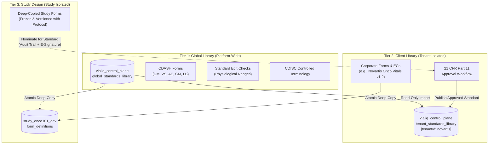

# Functional & Technical Specification: Global Standards Library, Client Library & Study Instantiation Engine

> **Document ID:** FTS-001  
> **Status:** APPROVED & ARCHITECTURALLY SEALED  
> **Target Platform:** Vialiq EDC & ePRO Platform  
> **Compliance Standards:** FDA 21 CFR Part 11 § 11.10(a),(e),(g), § 11.50; ICH GCP E6(R3) § 5.5; GAMP 5 Category 4/5; HIPAA § 164.312; CDISC CDASH v2.2 / SDTMIG v3.4  
> **Target Subsystems:** Form Designer (`libs/form-builder`), Backend API (`backend/api`), Polyglot Datastore (MongoDB / Redis)  

---

## 1. Executive Summary & System Overview

In enterprise clinical trials, re-designing common forms (Demographics, Vital Signs, Adverse Events) and re-authoring safety edit checks from scratch for every study introduces massive operational overhead, clinical error risk, and Computer System Validation (CSV) churn. 

This specification defines the **3-Tier Clinical Form Standards Hierarchy**:
1. **Tier 1: Global Library**: Platform-wide, CDISC-compliant standard templates provided by Vialiq. Open to all sponsors and CROs for read-only discovery and import.
2. **Tier 2: Client / Sponsor Library**: Corporate standards library owned strictly by a specific pharmaceutical sponsor or CRO. Populated by promoting verified local study designs through a formal **21 CFR Part 11 electronic approval workflow**. Cross-sponsor visibility or import is **strictly impossible**.
3. **Tier 3: Study-Level Design**: Live protocol-bound forms and edit checks inside a study database. Importing from Tier 1 or Tier 2 performs an **Atomic Deep-Copy (Instantiation)**, guaranteeing that active clinical trials are completely insulated against subsequent upstream changes.



---

## 2. Functional Requirements (FR)

### FR-1: 3-Tier Hierarchy & Scope
1. **Tier 1 (Global Library)**:
   * Maintained by the Vialiq Platform Standards Committee.
   * Ships pre-configured with CDASH/SDTM standard domains: `DM` (Demographics), `VS` (Vital Signs), `AE` (Adverse Events), `CM` (Concomitant Medications), `MH` (Medical History), `LB` (Laboratory Tests), and `EX` (Exposure).
   * Accessible by all authenticated study designers and CROs across all tenants in **Read-Only** mode.
2. **Tier 2 (Client Library)**:
   * Scoped strictly to an authenticated `tenantId`.
   * Holds corporate form definitions, custom visit schedules, complex composite widgets, and proprietary edit checks approved for use across that client's portfolio of clinical studies.
3. **Tier 3 (Study-Level Instance)**:
   * Dedicated to a specific study protocol within an isolated database (`study_{id}_dev`).
   * Can import from Tier 1 (Global) or Tier 2 (Client).
   * Any study-level form or edit check can be nominated for promotion to Tier 2.

---

### FR-2: Absolute Multi-Tenant Isolation (Zero Cross-Sponsor Leakage)
1. **Prohibition of Cross-Sponsor Discovery**:
   * Tenant A (e.g. Novartis) shall **never** discover, search, view, or import any form, field, rule, or metadata belonging to Tenant B (e.g. Roche).
   * All search, query, and catalog endpoints must enforce tenant boundary filters at the database and cache layers.
2. **CRO Multi-Tenant Persona**:
   * When a CRO user logs in, their session context is explicitly bound to a specific active client sponsor (via selected study or tenant workspace).
   * A CRO user cannot mix assets between Sponsor A and Sponsor B during a design session.

---

### FR-3: Client Library Promotion & Governance Approval Workflow
To promote a local study-level form or edit check into the Client Library:

```
               PROMOTION & GOVERNANCE WORKFLOW
                             │
 1. Study Nomination ────────┼──➔ Study Designer clicks "Nominate for Client Standard"
                             │    Enters change description & rationale
                             │
 2. Standards Review Queue ──┼──➔ Route to Client Standards Committee / Lead DM
                             │    Impact assessment on downstream studies
                             │
 3. Formal E-Signature ──────┼──➔ Mandatory 21 CFR Part 11 § 11.50 sign-off
                             │    - Meaning: "Approval of Corporate Standard"
                             │    - Re-authentication (Password / MFA TOTP)
                             │
 4. Version Allocation ──────┼──➔ Semantic Versioning (Major.Minor.Patch)
                             │
 5. Publication ─────────────┴──➔ Published to tenant_standards_library
                                  Available to all studies of THIS client
```

1. **Nomination**: Any authorized Study Designer can nominate a verified study form/EC.
2. **Review & Comparison**: The Client Standards Committee views the candidate side-by-side with previous versions, inspecting field schemas, bindings, and edit checks.
3. **Part 11 Electronic Signature (§ 11.50)**:
   * Promotion requires an authenticated electronic signature by an authorized Lead Data Manager or Standards Admin.
   * Captures: Signer identity, UTC timestamp, signature meaning (`"Approval - Corporate Standard Authorization"`), and mandatory justification.
4. **Semantic Versioning**:
   * Standards use `Major.Minor.Patch` (e.g., `1.0.0` $\rightarrow$ `1.1.0` for non-breaking additions; `2.0.0` for breaking removals/type alterations).

---

### FR-4: Atomic Deep-Copy Instantiation (Clinical Trial Stability)
1. **Strict Prohibition of Live References**:
   * An imported form **shall never be a live reference or symbolic link** to the library template.
   * If the Client Standards Committee modifies "Vital Signs" in the Client Library from `v1.0` to `v2.0`, active studies currently running `v1.0` **must remain 100% frozen and unaffected**.
   * Under ICH GCP E6(R3), an active clinical study cannot have its data collection instruments altered without a formal IRB/Ethics Committee Protocol Amendment.
2. **Deep-Copy Mechanics**:
   * Importing performs an atomic deep clone of the schema AST, field tokens, validation rules, layout grid, and localized translation keys into the study’s `form_definitions` collection.
   * Generates new, unique internal GUIDs for the study form while preserving CDISC variables (`fieldKey`, `sdtmVariable`).
3. **Provenance Block**:
   * Every imported form retains immutable origin metadata:
     ```json
     {
       "provenance": {
         "sourceTier": "CLIENT_LIBRARY",
         "originTenantId": "novartis",
         "templateId": "std_onco_vitals",
         "version": "1.2.0",
         "importedAt": "2026-10-27T08:00:00Z",
         "importedBy": "usr_dm_sarah"
       }
     }
     ```

---

### FR-5: Lifecycle Statuses & Deprecation Management
Templates in both Global and Client Libraries possess an explicit lifecycle state:

```
  ┌─────────┐      Submit      ┌──────────────┐     Approve (E-Sig)     ┌──────────┐
  │  Draft  │ ───────────────> │ Under Review │ ──────────────────────> │ Approved │
  └─────────┘                  └──────────────┘                         └──────────┘
                                      │ Reject                               │
                                      ▼                                      ▼ Deprecate
                                 ┌──────────┐                           ┌────────────┐
                                 │ Rejected │                           │ Deprecated │
                                 └──────────┘                           └────────────┘
                                                                               │ Retire
                                                                               ▼
                                                                        ┌────────────┐
                                                                        │  Retired   │
                                                                        └────────────┘
```

* **`Draft`**: Being authored; visible only to authors.
* **`Under Review`**: Locked for governance review.
* **`Approved`**: Active and available for import by studies.
* **`Deprecated`**: A newer standard exists; existing studies using it continue uninterrupted, but new studies receive a warning during import.
* **`Retired`**: Blocked from any new imports. Existing running studies retain their local deep-copied instance forever.

---

### FR-6: Form Builder UI/UX Experience
1. **Library Catalog Drawer**:
   * Integrated into `@vialiq/form-builder`.
   * Dual tabs: `Global Standards (Platform)` and `Corporate Standards (My Company)`.
   * Searchable by CDISC domain, keyword, or therapeutic area (e.g. Oncology, Cardiology).
2. **Interactive Preview**:
   * Clicking a template renders a live, interactive preview in `@vialiq/form-renderer` before importing.
3. **Conflict Resolution on Import**:
   * If an imported field key clashes with an existing field in the target study (e.g., `VS_SYSBP` already exists on another form), the engine prompts the designer:
     * *Option A*: Rename imported field alias (e.g. `VS_SYSBP_2`).
     * *Option B*: Map to existing study variable definition.
     * *Option C*: Abort import.

---

## 3. Technical Implementation (TI)

### TI-1: MongoDB Datastore Schema & Collection Topology

Library templates and study instances are stored across the multi-cluster hierarchy:

```
LAYER 1: CONTROL PLANE (Port 27017, vialiq_control_plane)
├── global_standards_library     # Platform-wide standards (Tier 1)
├── tenant_standards_library     # Client corporate standards (Tier 2, indexed by tenantId)
└── standards_approval_records   # 21 CFR Part 11 electronic signature audit logs

LAYER 2: STUDY DEV / UAT (Port 27027, study_{id}_dev)
└── form_definitions             # Deep-copied, study-scoped form definitions (Tier 3)
```

---

### TI-2: Data Model Specifications (BSON / JSON Schemas)

#### A. Standard Template Document (`tenant_standards_library`)
```json
{
  "_id": "tpl_onco_vitals_v1_2",
  "tenantId": "novartis",                     // Null for Global Library; string for Client Library
  "domain": "VS",                             // CDISC Domain Code
  "templateName": "Oncology Expanded Vital Signs",
  "category": "CLINICAL_ASSESSMENT",
  "description": "Standard 3-position blood pressure, pulse, temperature, and ECOG score",
  "version": "1.2.0",
  "lifecycleStatus": "APPROVED",
  
  /* --- The Canonical Schema Definition --- */
  "schema": {
    "title": "Vital Signs",
    "version": "1.2.0",
    "layout": {
      "type": "GRID",
      "columns": 12
    },
    "fields": [
      {
        "fieldKey": "VS_SYSBP",
        "sdtmVariable": "SYSBP",
        "label": "Systolic Blood Pressure",
        "controlType": "NUMBER_INPUT",
        "unit": "mmHg",
        "dataClassification": "ClinicalResearch",
        "validation": {
          "required": true,
          "min": 50,
          "max": 260
        }
      },
      {
        "fieldKey": "VS_DIABP",
        "sdtmVariable": "DIABP",
        "label": "Diastolic Blood Pressure",
        "controlType": "NUMBER_INPUT",
        "unit": "mmHg",
        "dataClassification": "ClinicalResearch",
        "validation": {
          "required": true,
          "min": 30,
          "max": 180
        }
      }
    ],
    "editChecks": [
      {
        "checkId": "EC_VS_SYS_GT_DIA",
        "name": "Systolic Greater Than Diastolic",
        "severity": "ERROR",
        "ruleLogic": {
          ">": [{ "var": "VS_SYSBP" }, { "var": "VS_DIABP" }]
        },
        "errorMessage": "Systolic BP must be strictly greater than Diastolic BP."
      }
    ]
  },

  /* --- Governance & Part 11 Approval Metadata --- */
  "governance": {
    "nominatedBy": "usr_dm_sarah",
    "nominatedFromStudyId": "STUDY_ONCO_101",
    "approvedBy": "usr_lead_marcus",
    "approvedAt": "2026-10-27T08:15:00Z",
    "signatureRecordId": "sig_app_9918237",
    "approvalReason": "Promoted to Global Oncology Corporate Standard following Phase 2 pilot review."
  },

  "createdAt": "2026-10-20T10:00:00Z",
  "updatedAt": "2026-10-27T08:15:00Z"
}
```

#### B. Electronic Signature Record (`standards_approval_records`)
```json
{
  "_id": "sig_app_9918237",
  "tenantId": "novartis",
  "templateId": "tpl_onco_vitals_v1_2",
  "templateVersion": "1.2.0",
  "action": "AUTHORIZE_CORPORATE_STANDARD",
  "signedAt": "2026-10-27T08:15:00Z",
  "signer": {
    "userId": "usr_lead_marcus",
    "fullName": "Marcus Vance, MS",
    "role": "LEAD_DATA_MANAGER",
    "email": "marcus.vance@novartis.com",
    "ipAddress": "198.51.100.42"
  },
  "signatureDeclaration": "I hereby certify that I have reviewed this Case Report Form template and approve it as an official corporate clinical standard.",
  "authMethod": "PASSCODE_PLUS_TOTP",
  "cryptographicHash": "e3b0c44298fc1c149afbf4c8996fb92427ae41e4649b934ca495991b7852b855"
}
```

---

### TI-3: Multi-Tenant Security & Discovery Enforcement

To make cross-sponsor leaks mathematically impossible, query operations run through the **`TenantIsolationFilter`**:

```csharp
namespace Vialiq.Infrastructure.Security;

public class ClientLibraryRepository : IClientLibraryRepository
{
    private readonly IMongoCollection<StandardTemplateDocument> _templates;
    private readonly ITenantStudyContextAccessor _contextAccessor;

    public ClientLibraryRepository(
        IMongoDatabase controlPlaneDb,
        ITenantStudyContextAccessor contextAccessor)
    {
        _templates = controlPlaneDb.GetCollection<StandardTemplateDocument>("tenant_standards_library");
        _contextAccessor = contextAccessor;
    }

    public async Task<IReadOnlyList<StandardTemplateDocument>> GetApprovedTemplatesAsync(
        string? domainFilter,
        CancellationToken ct)
    {
        var tenantId = _contextAccessor.CurrentContext?.TenantId;
        
        // FAIL-CLOSED: Absolute barrier against unauthenticated or missing tenant calls
        if (string.IsNullOrWhiteSpace(tenantId))
        {
            throw new SecurityException("Access to Client Library denied: Missing authenticated Tenant context.");
        }

        // HARD FILTER: Query is strictly locked to this tenant's boundaries
        var filter = Builders<StandardTemplateDocument>.Filter.And(
            Builders<StandardTemplateDocument>.Filter.Eq(t => t.TenantId, tenantId),
            Builders<StandardTemplateDocument>.Filter.Eq(t => t.LifecycleStatus, "APPROVED")
        );

        if (!string.IsNullOrWhiteSpace(domainFilter))
        {
            filter &= Builders<StandardTemplateDocument>.Filter.Eq(t => t.Domain, domainFilter.ToUpperInvariant());
        }

        return await _templates.Find(filter).ToListAsync(ct);
    }
}
```

---

### TI-4: Distributed Caching Architecture (Redis)

Caching conforms to the 3-tier namespacing architecture:

```csharp
namespace Vialiq.Infrastructure.Caching;

public class StandardsLibraryCacheService : IStandardsLibraryCacheService
{
    private readonly IScopedCacheService _cacheService;
    private readonly ITenantStudyContextAccessor _contextAccessor;

    public StandardsLibraryCacheService(
        IScopedCacheService cacheService,
        ITenantStudyContextAccessor contextAccessor)
    {
        _cacheService = cacheService;
        _contextAccessor = contextAccessor;
    }

    // 1. GLOBAL LIBRARY CACHE (Shared across all sponsors - Read-Only)
    public async ValueTask<StandardTemplateDocument?> GetGlobalTemplateAsync(
        string templateId, 
        string version, 
        Func<CancellationToken, ValueTask<StandardTemplateDocument?>> factory,
        CancellationToken ct)
    {
        return await _cacheService.GetOrCreateGlobalAsync(
            "lib:tpl",
            $"{templateId}:{version}",
            factory,
            ct);
    }

    // 2. CLIENT LIBRARY CACHE (Strictly isolated by TenantId)
    public async ValueTask<StandardTemplateDocument?> GetClientTemplateAsync(
        string templateId, 
        string version, 
        Func<CancellationToken, ValueTask<StandardTemplateDocument?>> factory,
        CancellationToken ct)
    {
        return await _cacheService.GetOrCreateClientLibraryAsync(
            "lib:tpl",
            $"{templateId}:{version}",
            factory,
            ct);
    }
}
```

---

### TI-5: Deep-Copy Instantiation Engine (.NET 9)

When the Study Designer clicks "Import to Study", the `StudyInstantiationService` creates the decoupled copy:

```csharp
namespace Vialiq.Core.Services;

public class StudyInstantiationService : IStudyInstantiationService
{
    private readonly ITenantDatabaseResolver _dbResolver;
    private readonly IAuditTrailRepository _auditRepo;

    public async Task<FormDefinitionEntity> InstantiateToStudyAsync(
        string studyId,
        StandardTemplateDocument template,
        UserContext actor,
        CancellationToken ct)
    {
        var studyDb = _dbResolver.GetStudyDatabase(studyId, EnvironmentType.Dev);
        var formCollection = studyDb.GetCollection<FormDefinitionEntity>("form_definitions");

        // 1. Deep clone the schema object
        var clonedSchema = CloneObject(template.Schema);

        // 2. Build the study-level aggregate root
        var studyForm = new FormDefinitionEntity
        {
            Id = $"form_{template.Domain.ToLowerInvariant()}_{Guid.NewGuid():N}",
            StudyId = studyId,
            FormKey = $"FORM_{template.Domain}_{DateTime.UtcNow:yyyyMMdd}",
            Version = "1.0-draft",
            Status = FormStatus.Draft,
            Schema = clonedSchema,
            Provenance = new ProvenanceBlock
            {
                SourceTier = template.TenantId == null ? "GLOBAL_LIBRARY" : "CLIENT_LIBRARY",
                OriginTenantId = template.TenantId ?? "_PLATFORM",
                TemplateId = template.Id,
                TemplateVersion = template.Version,
                ImportedAtUtc = DateTime.UtcNow,
                ImportedByUserId = actor.UserId
            }
        };

        // 3. Persist inside study dev database
        await formCollection.InsertOneAsync(studyForm, cancellationToken: ct);

        // 4. Record design-time audit event in study dev audit collection
        var auditEntry = AuditTrailEntry.CreateDesignEvent(
            studyId: studyId,
            entityType: "FORM_SCHEMA",
            entityId: studyForm.Id,
            action: "TEMPLATE_IMPORTED",
            actor: actor,
            reason: $"Imported template {template.TemplateName} (v{template.Version}) from {studyForm.Provenance.SourceTier}"
        );

        await _auditRepo.InsertBatchAsync(new[] { auditEntry }, ct);

        return studyForm;
    }

    private static T CloneObject<T>(T source) =>
        JsonSerializer.Deserialize<T>(JsonSerializer.Serialize(source))!;
}
```

---

### TI-6: Angular 21 Form Builder Integration

In `libs/form-builder`, the UI provides the **Standards Drawer Component**:

```typescript
// libs/form-builder/src/lib/components/library-drawer/library-catalog-drawer.component.ts
import { Component, inject, signal } from '@angular/core';
import { CommonModule } from '@angular/common';
import { StandardsLibraryService, StandardTemplate } from '../../services/standards-library.service';

@Component({
  selector: 'vialiq-library-catalog-drawer',
  standalone: true,
  imports: [CommonModule],
  template: `
    <aside class="standards-drawer" [class.open]="isOpen()">
      <div class="drawer-header">
        <h3>Clinical Standards Catalog</h3>
        <div class="tab-pills">
          <button [class.active]="activeTab() === 'GLOBAL'" (click)="setTab('GLOBAL')">
            Global CDASH
          </button>
          <button [class.active]="activeTab() === 'CLIENT'" (click)="setTab('CLIENT')">
            Corporate Standards
          </button>
        </div>
      </div>

      <div class="catalog-list">
        @for (tpl of filteredTemplates(); track tpl._id) {
          <div class="template-card">
            <div class="card-domain-badge">{{ tpl.domain }}</div>
            <h4>{{ tpl.templateName }} <span class="ver">v{{ tpl.version }}</span></h4>
            <p>{{ tpl.description }}</p>
            
            <div class="card-actions">
              <button class="btn-preview" (click)="openPreview(tpl)">Preview</button>
              <button class="btn-import" (click)="importToStudy(tpl)">Import to Study</button>
            </div>
          </div>
        }
      </div>
    </aside>
  `
})
export class LibraryCatalogDrawerComponent {
  private libraryService = inject(StandardsLibraryService);
  
  isOpen = signal<boolean>(false);
  activeTab = signal<'GLOBAL' | 'CLIENT'>('CLIENT');
  templates = signal<StandardTemplate[]>([]);

  filteredTemplates = computed(() => 
    this.templates().filter(t => this.activeTab() === 'GLOBAL' ? !t.tenantId : !!t.tenantId)
  );

  setTab(tab: 'GLOBAL' | 'CLIENT') {
    this.activeTab.set(tab);
    this.loadCatalog(tab);
  }

  async loadCatalog(tab: 'GLOBAL' | 'CLIENT') {
    const data = await this.libraryService.fetchCatalog(tab);
    this.templates.set(data);
  }

  async importToStudy(template: StandardTemplate) {
    await this.libraryService.instantiateTemplate(template._id);
    // Dispatches state event to reload active form canvas in libs/state-fp
  }
}
```

---

## 4. Verification & Testing Standards

1. **Cross-Tenant Attack Unit Test**:
   * A simulated user session authenticated as Tenant `roche` issues a request to `GET /api/v1/library/client/templates?tenantId=novartis`.
   * Asserts that `TenantIsolationFilter` throws `SecurityException` and returns HTTP `403 Forbidden`.
2. **Deep-Copy Mutation Isolation Test**:
   * Study 101 imports "Vital Signs v1.0".
   * The Client Library template is updated to "Vital Signs v2.0".
   * Asserts that Study 101's form schema remains completely identical to `v1.0` with zero schema drift.
3. **Electronic Signature Integrity Test**:
   * Test promotes a form to Client Library without a valid password/MFA credential.
   * Asserts that promotion fails with `SignatureAuthenticationRequiredException`.
   * Test with valid credentials asserts that a tamper-evident SHA-256 hash record is written to `standards_approval_records`.
