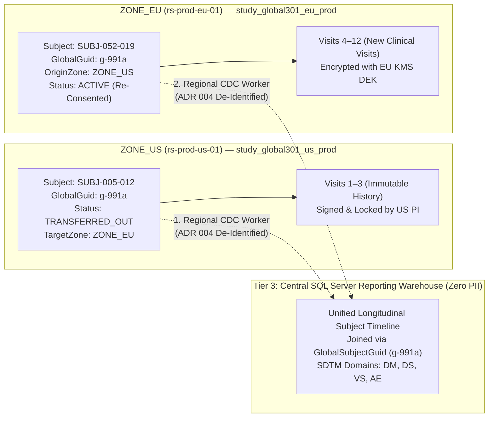

# Functional & Technical Specification: Inter-Zone Patient Transfers, Multi-National Health Authority Inspections & Study Governance

> **Document ID:** `FTS-003`  
> **Status:** APPROVED & ARCHITECTURALLY SEALED  
> **Target Platform:** Vialiq EDC & ePRO Platform  
> **Compliance Standards:** FDA 21 CFR Part 11 (§ 11.10, § 11.50, § 11.200), ICH GCP E6(R3), EU CTR 536/2014, GDPR (Art. 9, 17, 44–49, 89), EMA Guideline on Computerised Systems and Electronic Data in Clinical Trials, HIPAA (§ 164.312, § 164.514), China PIPL/DSL/HGRAC, NMPA GCP, CDISC SDTM v3.4  
> **Related Specifications:**
> - [Scale 005-A: Multilingual Global Studies & Site-Group Geo-Partitioning](../scaling-architecture/005-a-multilingual-study-db-per-site-group-and-reporting-guide.md)
> - [Scale 005: Database Cluster Farm & Regional Compliance](../scaling-architecture/005-database-cluster-farm-regional-compliance-and-throughput-scaling.md)
> - [ADR 004: CSFLE-to-SQL Server CDC Ingress Boundary](../critical-problems-and-adrs/004-csfle-to-sql-server-cdc-decryption-boundary-adr.md)
> - [ADR 009: Legal Timestamp Authority & Non-Sharded Ordering](../critical-problems-and-adrs/009-distributed-clock-skew-and-part-11-audit-timestamp-integrity-adr.md)
> - [006: Field-Level Encryption (CSFLE) & Regional Key Vault Architecture](../backend-architecture/database/006-field-level-encryption-csfle-and-key-management-architecture.md)

---

## 1. Executive Summary & Architectural Scope

When conducting pivotal multi-national clinical trials across sovereign storage zones (`ZONE_US`, `ZONE_EU`, `ZONE_CN`), three complex operational, regulatory, and governance scenarios arise beyond initial site enrollment:

1. **Inter-Zone Patient Transfers (Relocations):** A trial participant moves from a clinical site in one sovereign storage zone (e.g., Houston, USA) to an active trial site in another sovereign zone (e.g., London or Berlin, EEA).
2. **Multi-National Health Authority Inspections:** Regulatory inspectors from the **US FDA (BIMO)**, **European EMA / National Competent Authorities**, and **China NMPA** require live read-only inspection access, certified PDF archival packets, and machine-readable dynamic audit trail exports without violating host-nation data residency laws.
3. **SOW-Flexible Study Configuration Governance & Pre-Go-Live Locking:** Balancing real-world clinical feasibility (where countries and sites are identified before database build) with flexible SaaS Statement of Work (SOW) models allowing either Sponsor self-service or Vialiq Professional Services configuration via RBAC (`STUDY_INFRA_CONFIG`).

---

## 2. Part A: Inter-Zone Subject Relocation & Custody Transfer

### 2.1 The Regulatory Dilemma: Part 11 Custody Immutability vs. Data Residency
In a longitudinal clinical trial lasting 3–5 years, a subject enrolled at **Site 005 (MD Anderson, Houston — `ZONE_US`)** may permanently relocate to Berlin and continue trial participation at **Site 052 (Charité Berlin — `ZONE_EU`)**.

* **Why Deleting/Moving MongoDB Documents is Illegal:**
  1. Deleting Visits 1–3 from `study_global301_us_prod` and inserting them into `study_global301_eu_prod` violates **FDA 21 CFR Part 11 § 11.10(e)** audit immutability and breaks the origin primary's monotonic audit hash chain ([ADR 009](../critical-problems-and-adrs/009-distributed-clock-skew-and-part-11-audit-timestamp-integrity-adr.md)).
  2. Silently replicating US patient PII (`SiteIdentifier` DEK-wrapped fields) into a European production database (or EU PII into a US database) violates regional data custody laws and destroys regional KMS key isolation.

### 2.2 The Origin Custody Preservation + Destination Linkage Architecture



### 2.3 Step-by-Step Inter-Zone Transfer Workflow

1. **Pre-Transfer Origin Lock & Sign-Off (`ZONE_US`):**
   * The Origin Principal Investigator (PI) at Site 005 completes, resolves open queries on, and applies final e-signature lock to Visits 1–3 in `study_global301_us_prod`.
   * The Origin Study Admin or Lead CRA triggers `POST /api/v1/subjects/{subjectId}/actions/initiate-inter-zone-transfer`.
   * **21 CFR Part 11 Challenge Gate (HTTP 428):** Requires dual-credential password re-authentication + mandatory reason code (`"SUBJECT_RELOCATION"`).
   * Origin subject status transitions to **`TRANSFERRED_OUT`**; further clinical data entry at Site 005 is hard-locked (`HTTP 423`). Visits 1–3 remain permanently anchored in `ZONE_US` for US FDA inspection traceability.

2. **Cross-Border Clinical Summary Hand-Off (Protocol & Consent Governed):**
   * Under ICH GCP E6(R3) and GDPR Art. 49 (explicit informed consent / transfer authorization), if Site 052 clinically needs the patient's historical medical baseline (e.g., cumulative chemotherapy dose or prior SAEs) to safely treat the patient:
     * A time-bound, water-marked **Certified Clinical Transfer Packet (PDF)**—excluding system backend internals and respecting double-blind RTSM masking ([ADR 010](../critical-problems-and-adrs/010-double-blind-rtsm-unblinding-prevention-in-caching-tiers-adr.md))—is generated for documented investigator-to-investigator medical handoff and filed in the Trial Master File (TMF).

3. **Destination Re-Consent & Linked Enrollment (`ZONE_EU`):**
   * At Site 052 (Berlin), the participant signs the local EEA Informed Consent Form (ICF) covering GDPR Art. 9 processing.
   * Destination Site Staff register the subject in `study_global301_eu_prod` using the validated **"Enroll Transferred Subject"** action, generating local ID `SUBJ-052-019` while linking:
     ```json
     {
       "subjectId": "SUBJ-052-019",
       "globalSubjectGuid": "991a2c40-8b2d-4f1a-9f88-112233445566",
       "transferMetadata": {
         "isTransferredSubject": true,
         "originZoneId": "ZONE_US",
         "originSiteId": "SITE-005",
         "originSubjectId": "SUBJ-005-012",
         "transferEffectiveVisitKey": "VISIT_04",
         "reConsentSignedAtUtc": "2026-11-10T10:15:00Z"
       }
     }
     ```
   * Patient identity (`SiteIdentifier` PII) at Site 052 is protected by a brand-new `ZONE_EU` CSFLE Data Encryption Key wrapped by AWS Frankfurt KMS.
   * All visits from Visit 4 onward are saved strictly to `study_global301_eu_prod`.

4. **Longitudinal Statistical Continuity (Central SQL Server Tier 3):**
   * Both `ZONE_US` and `ZONE_EU` regional CDC workers stream de-identified `ClinicalResearch` records (zero PII per [ADR 004](../critical-problems-and-adrs/004-csfle-to-sql-server-cdc-decryption-boundary-adr.md)) tagged with `GlobalSubjectGuid` to the Central SQL Server 2022 reporting database.
   * Biostatistical SQL views join on `GlobalSubjectGuid`, presenting one seamless, continuous Visits 1–12 clinical efficacy/safety timeline across SDTM domains (`DM` Demographics, `DS` Disposition, `VS` Vitals, `AE` Adverse Events) with accurate origin/transfer site attribution (`SITEID`).

5. **Double-Blind Protection During Transfer:**
   * Regardless of relocation, the patient's RTSM randomization assignment continues strictly under `BlindedRTSM` masking ([ADR 010](../critical-problems-and-adrs/010-double-blind-rtsm-unblinding-prevention-in-caching-tiers-adr.md)). Neither origin nor destination investigators ever see treatment arm allocations; IP drug resupply continues seamlessly via central IXRS/RTSM kit dispatch referencing `GlobalSubjectGuid`.

---

## 3. Part B: Multi-National Health Authority Inspection Readiness

Regulatory authorities—specifically the **US FDA (Bioresearch Monitoring / BIMO)**, **European EMA / National Competent Authorities (BfArM, ANSM, MHRA)**, and **China NMPA**—audit electronic trial records with non-negotiable transparency and export demands.

### 3.1 Scoped Live Read-Only Inspector Access (`Auditor` Role)
Inspectors must be able to log into the live (or read-only archived) platform directly with dedicated, time-bound read-only credentials (`ClinicalRoles.QaAuditor` / `INSPECTOR`):

* **Strict Regional & Site Scoping:**
  * An **NMPA Inspector** inspecting a Shanghai center is issued credentials bound to `TenantId + StudyId + AuthorizedSiteIds (ZONE_CN)`. [`DynamicClinicalDatabaseResolver`](../scaling-architecture/005-a-multilingual-study-db-per-site-group-and-reporting-guide.md#45-the-unified-database-provider-dynamicclinicaldatabaseresolver) routes 100% of their queries strictly to `rs-prod-cn-01` (`study_global301_cn_prod`), demonstrating verifiable in-country data localization.
  * An **EMA Inspector** auditing sites in Germany/France routes exclusively to `rs-prod-eu-01` (`study_global301_eu_prod`).
  * An **FDA BIMO Inspector** inspecting US clinical sites routes directly to `rs-prod-us-01` (`study_global301_us_prod`), and can audit sponsor-held central oversight records.
* **Mandatory In-UI Traceability:**
  1. **Zero Data Obscuration:** Clicking any field displays its full chronological history ("Who, What, When, Why")—showing original entered values, subsequent modifications, mandatory Reason for Change, and e-signature attributions without hiding legacy values.
  2. **Coordinated Dual-Timestamp Rendering:** Every audit event stores authoritative UTC (`serverTimestampUtc` stamped by the regional MongoDB Primary per ADR 009) paired with `clientTimeZoneId` / localized display conversion so local clinic staff and auditors align effortlessly with hospital paper/EMR charts.
  3. **Dual-Language Side-by-Side Inspection (`Base ↔ Site`):** For sites entering forms in non-base languages (e.g., Simplified Chinese or German), inspectors viewing Data Entry pages can toggle seamlessly between **`Site Language`** and **`Base Language`**, and configured translatable free-text fields (`AE.AETERM`, `MH.MHTERM`, `CM.CMTRT`) display **both the preserved original local verbatim** and the **Base Language translation**.
  4. **GDPR Article 17 Graceful Display:** If an EU patient invoked Right to Erasure via DEK crypto-shredding ([`006-field-level-encryption`](./../backend-architecture/database/006-field-level-encryption-csfle-and-key-management-architecture.md)), the inspector sees `[REDACTED — GDPR ARTICLE 17 ERASURE EXECUTED]` in the scrubbed PII slots alongside the intact `auditSequence`, `serverTimestampUtc`, and verified SHA-256 hash chain.

### 3.2 Certified Export Matrix: Human-Readable PDF & EMA Dynamic Exports

| Export Format | Primary Regulatory Mandate | Technical Specification & Contents | Processing Architecture |
|---|---|---|---|
| **Certified Patient eCRF PDF Book (PDF/A-2b)** | **US FDA 21 CFR Part 11**, ICH GCP E6(R3), Sponsor Archival (EU CTR 25-Yr) | Bookmarked per subject & visit; includes rendered CRF layout, open/closed discrepancy queries, **full data-point audit trail table**, and formal **e-signature manifestations** (Printed Name, Date/Time, Meaning of Signature). Digitally signed with SHA-256 + timestamp. | Asynchronous RabbitMQ Worker (`q.pdf.patient-book` inside the target region's VPC to keep PII local during generation). |
| **Dynamic Machine-Readable Audit Export (XML / CSV)** | **EMA Guideline on Computerised Systems and Electronic Data in Clinical Trials** | Structured tabular export containing `GlobalSubjectGuid` / `SubjectId`, `SiteId`, `AuditSequence`, `ServerTimestampUtc`, `ActorUserId`, `ActorRole`, `FieldKey`, `OldValue` (redacted if crypto-shredded), `NewValue`, `ReasonForChange`, `SignatureHash`. Enables inspectors to run statistical pattern scripts to detect systemic anomalies (e.g., back-dating patterns, excessive post-visit edits). | Scoped Regional Worker (`q.exports.audit`) streaming compressed CSV / ODM-XML strictly for authorized sites within the inspector's regional boundary. |
| **Global Submission Datasets (CDISC SDTM / ADaM)** | **US FDA NDA / EMA MAA / PMDA / NMPA Submission** | Pooled de-identified `ClinicalResearch` datasets (`DM`, `AE`, `VS`, `LB`, `EX`, `DS`) generated from Central SQL Server Tier 3 reporting warehouse (`SiteIdentifier` PII dropped at regional CDC boundary per ADR 004; free-text verbatims scrubbed/coded via MedDRA & WHODrug). | Regional CDC Workers $\rightarrow$ Central SQL Server 2022 Columnstore $\rightarrow$ Validation & SAS/XPT Export. |

---

## 4. Part C: Study Configuration Governance, Pre-Go-Live Locking & SOW RBAC

### 4.1 Real-World Feasibility & Pre-Go-Live Configuration Lock
In enterprise clinical trials, regulatory submissions (FDA IND, EU CTIS, China NMPA CTA), country feasibility, and hospital site identification occur months **prior** to EDC database build and First-Patient-In (FPI). A sponsor does not impulsively enable a new sovereign country post-go-live without extensive ethics approvals and protocol amendments.

Consequently, Vialiq enforces the **Pre-Go-Live Configuration Lock**:

1. **Editable Window (`DRAFT` / `DEV` / `UAT` Prior to First Subject Screening in `PROD`):**
   * While a study has zero live subjects in `PROD`, authorized technical admins can configure:
     * `storageTopology.mode` (`Single` default | `MultiRegionGeoPartitioned`)
     * Regional `zones` (`ZONE_US`, `ZONE_EU`, `ZONE_CN`) and regional KMS/KeyVault references
     * `translationConfig` (`baseLocale` — English or non-English e.g. `ja-JP`/`zh-CN`, and supported UI/translation `locales`)
     * `medicalCodingConfig` (`MedDRA` / `WHODrug` dictionary versions)
2. **Hard Immutable Lock Upon `PROD` Data Entry Activation:**
   * Once data entry starts in `PROD`, flipping `storageTopology.mode`, deleting/modifying existing `zones`, changing `baseLocale`, or dropping/renaming active `locales` is **strictly blocked** at both API middleware and MongoDB schema validation layers.
3. **Extraordinary Mid-Study Sovereign Expansion (Additive Amendment Procedure):**
   * If a rare Phase 3 Protocol Amendment requires onboarding a new country or UI language *after* `PROD` Go-Live:
     * **Pre-requisite:** The study must already be provisioned in `MultiRegionGeoPartitioned` mode (a `Single` mode trial cannot mutate into multi-region silently at runtime without a formal DBA-governed database migration & validation package).
     * **Additive-Only Rule:** Only adding a **new isolated zone** (for newly created sites) or adding a **new translation `locale`** bundle is allowed through a controlled GxP Change-Control Amendment & DBA migration procedure—never altering or deleting existing active zones or existing site assignments.

### 4.2 Flexible SOW Governance via RBAC Privilege (`STUDY_INFRA_CONFIG`)

In clinical SaaS delivery, different client Statements of Work (SOWs) dictate different operating responsibilities:
* **Model 1 — Managed Services SOW:** The pharmaceutical sponsor prefers Vialiq's internal Implementation / Support Engineers to configure study infrastructure, regional storage zones, and coding dictionary versions.
* **Model 2 — Self-Service Enterprise SOW:** A large sponsor (e.g., Roche, Pfizer) with an internal clinical IT programming organization manages these technical configurations themselves.

Instead of hardcoding who can configure infrastructure into separate UI apps or external deployments, configuration access is governed dynamically via a **composable RBAC permission**: **`STUDY_INFRA_CONFIG`**.

```
┌────────────────────────────────────────────────────────────────────────────────────────────────────────┐
│                       SEPARATION OF DUTIES (SoD) & SOW RBAC GOVERNANCE                                 │
├────────────────────────────────────────┬───────────────────────────────────────────────────────────────┤
│ Role / Persona                         │ Capabilities & Hard Security Boundary                         │
├────────────────────────────────────────┼───────────────────────────────────────────────────────────────┤
│ 1. Platform SRE / Cloud DevOps         │ • Manages physical hardware, MongoDB Replica Sets (`rs-*`),   │
│    (Internal Infrastructure Team)      │   AWS/Aliyun VPC peering, KMS HSM ARNs, & TLS certificates.   │
│                                        │ • Publishes pre-certified **"Zone Profiles"** to catalog      │
│                                        │   (e.g., `PROFILE_US_HIPAA_01`, `PROFILE_EU_GDPR_01`).        │
├────────────────────────────────────────┼───────────────────────────────────────────────────────────────┤
│ 2. Tenant Admin / Onboarding Admin     │ • Enforces the client's contractual SOW boundary.             │
│    (Sponsor Org Lead / Account Exec)   │ • Grants or revokes **`STUDY_INFRA_CONFIG`** privilege per study│
│                                        │   to EITHER Vialiq Support Engineers OR Client Technical Lead. │
├────────────────────────────────────────┼───────────────────────────────────────────────────────────────┤
│ 3. `STUDY_INFRA_CONFIG` Holder         │ • Selects `Single` vs `MultiRegionGeoPartitioned` before FPI. │
│    (Vialiq Support OR Client Tech Lead)│ • Maps study to **pre-certified Zone Profiles** ONLY (never   │
│                                        │   enters raw Mongo URIs/passwords — eliminates SSRF & leaks!).│
│                                        │ • Configures `baseLocale`, `locales`, & Medical Coding DBs.   │
├────────────────────────────────────────┼───────────────────────────────────────────────────────────────┤
│ 4. Study Admin / Clinical Data Manager │ • Focuses on clinical setup: sites, investigators, countries, │
│    (Clinical Operations Role)          │   CRA monitoring assignments, form build & UAT dry-runs.      │
│                                        │ • Cannot self-escalate to acquire `STUDY_INFRA_CONFIG`.       │
│                                        │ • Requests site override (`CHE -> ZONE_EU`) via 21 CFR Part 11│
│                                        │   e-signature + clinical justification.                       │
└────────────────────────────────────────┴───────────────────────────────────────────────────────────────┘
```

### 4.3 Security Invariant: Catalog Abstraction (Zero Plaintext Secrets in Study Config)
A holder of `STUDY_INFRA_CONFIG` (whether client staff or Vialiq support) **never enters raw MongoDB connection strings, replica set passwords, or IAM Secret Keys** into the Admin UI.
* Instead, the Study Registry binds strictly to validated `ZoneProfileId` references maintained by Platform SRE (e.g., `ZONE_PROFILE_EU_DE_01`).
* The .NET 9 backend (`DynamicClinicalDatabaseResolver`) resolves the actual encrypted connection secrets and KMS credentials strictly from Vault/Secrets Manager inside the cluster VPC. This completely eliminates Server-Side Request Forgery (SSRF), unauthorized cross-tenant routing, and credential leakage across both Managed and Self-Service SOW models.

### 4.4 End-to-End Infrastructure Ownership & Execution Matrix

To eliminate ambiguity between platform infrastructure provisioning, client SOW responsibilities, and day-to-day clinical operations, every technical subsystem follows this explicit **Who & How** ownership boundary:

```
=======================================================================================================================
INFRASTRUCTURE LIFECYCLE OWNERSHIP MATRIX (CLUSTERS, KEY VAULTS, BACKUPS & ARCHIVAL)
=======================================================================================================================
Subsystem / Action        Primary Owner (WHO)             How It Is Configured & Executed
-----------------------------------------------------------------------------------------------------------------------
1. MongoDB Clusters &     Platform SRE / Cloud DevOps     • Provisions 3-node Replica Sets across 3 AZs per sovereign
   Replica Sets                                             region (`rs-prod-us`, `rs-prod-eu`, `rs-prod-cn`), VPC peering,
   (No Collection Sharding)                                 TLS certs, & VPC Secrets Manager credentials via IaC.
                                                          • Exposes pre-certified `ZoneProfileId` entries only.
-----------------------------------------------------------------------------------------------------------------------
2. Study Cluster Binding  `STUDY_INFRA_CONFIG` Holder     • Binds study pre-Go-Live in `vialiq_control_plane.study_registry`
   & Mega-Study Promotion (Vialiq Support OR Client Lead    via `ZoneProfileId` (zero raw connection strings).
                          per Tenant Admin SOW grant)     • Liquibase runs baseline compound-index migrations on provisioning.
                                                          • Studies > 2 TB promoted to dedicated replica sets by SRE.
-----------------------------------------------------------------------------------------------------------------------
3. Key Vaults & KMS       Platform SRE + Sponsor SecOps   • SRE/SecOps provisions Cloud KMS CMKs & isolated Key Vault DBs
   (Single / Regional /   (Sponsor Cloud Admin for BYOK)    (`keyvault_study_{id}_{zone}.__keyVault` in EU/CN clusters).
   BYOK Models)                                           • For BYOK, Sponsor SecOps creates CMK in Sponsor's own AWS/Azure
                                                            account and grants Vialiq VPC worker IAM `kms:Decrypt`/`Encrypt`.
                                                          • `STUDY_INFRA_CONFIG` binds non-secret KMS ARN/namespace pointers.
                                                          • Runtime unwrapping uses native `libmongocrypt` (zero IMemoryCache).
-----------------------------------------------------------------------------------------------------------------------
4. Continuous Backups &   Platform SRE (Mandatory         • Automated platform baseline (zero clinical user configuration):
   PITR / DR Drills       Automated Platform Baseline)      hourly WiredTiger snapshots + 60s continuous `oplog.rs` archiving
                                                            to encrypted region-local S3 buckets (`RPO <= 5m`, `RTO <= 60m`).
                                                          • Kubernetes CronJob runs automated Sunday 02:00 UTC DR restore
                                                            + SHA-256 `audit_trail` verification (`system_dr_audit_reports`).
-----------------------------------------------------------------------------------------------------------------------
5. Database Lock (DBL) &  Clinical Data Mgr +             • Data Mgr / PI triggers Progressive Lock / Final Study Hard Lock.
   25-Year WORM Archival  Platform Automated Workers      • Automated policy transitions KMS CMKs to `DENY_KEY_CREATION` (DBL)
                                                            and packages CDISC ODM-XML + PDF/A + XPT + BSON dumps into S3
                                                            Glacier Object Lock (`COMPLIANCE` mode, 25-year retention).
-----------------------------------------------------------------------------------------------------------------------
6. Legal Hold & GDPR      Sponsor Legal Officer / DPO     • Legal Officer toggles `isLegalHold: true` in Control Plane to
   Crypto-Shredding                                         halt all decommissioning & deletion indefinitely.
                                                          • DPO / Authorized Admin executes subject DEK deletion in the Site
                                                            Zone's `__keyVault`, erasing CRF & Audit PII (`[REDACTED]`).
-----------------------------------------------------------------------------------------------------------------------
7. Sites, Countries &     Study Admin / Lead CRA          • Registers trial sites (`CountryCode`, immutable `SiteLanguage`).
   Sovereign Overrides    (Clinical Operations Role)      • Executes Part 11 e-signed sovereign overrides (e.g., CHE → EU).
                                                          • Blocked from modifying `storageTopology` once PROD FPI begins.
=======================================================================================================================
```


