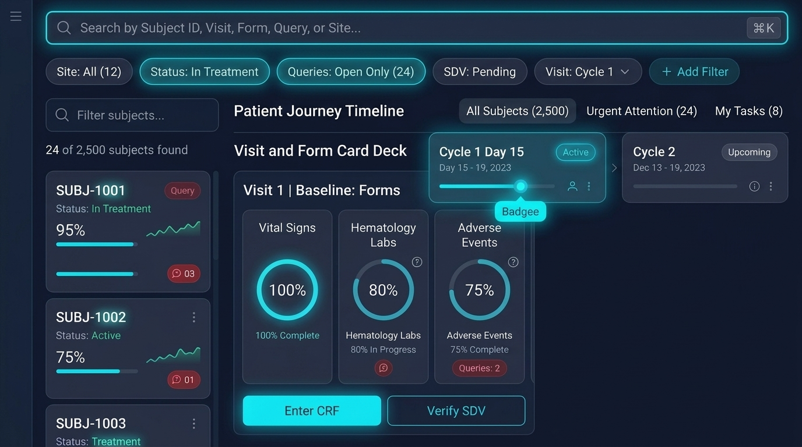
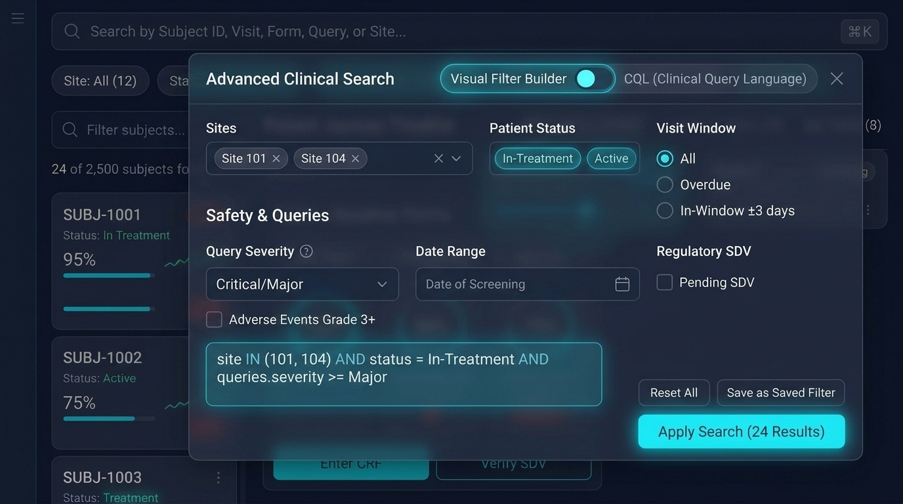
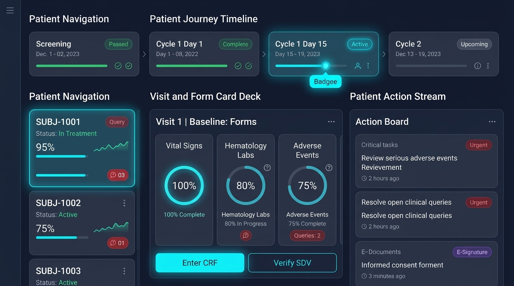
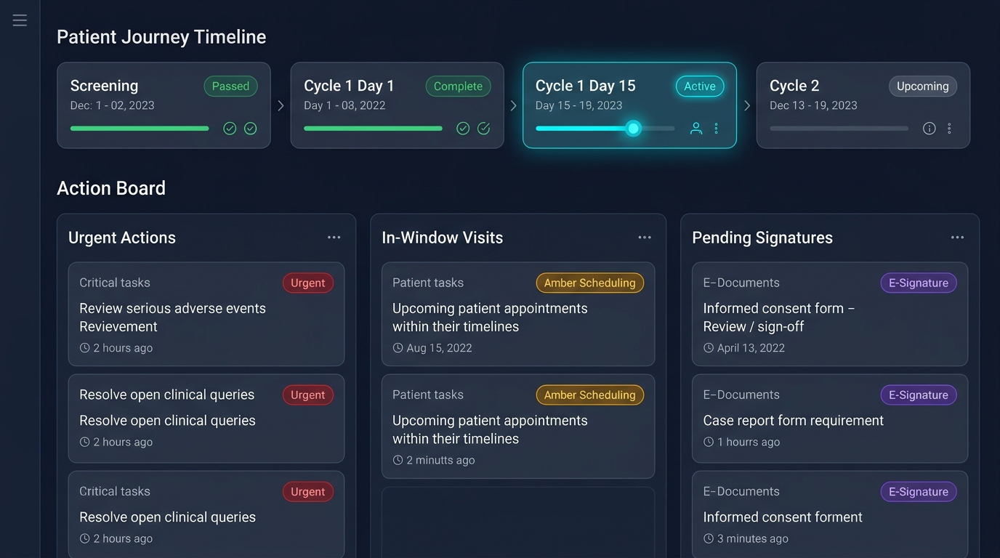
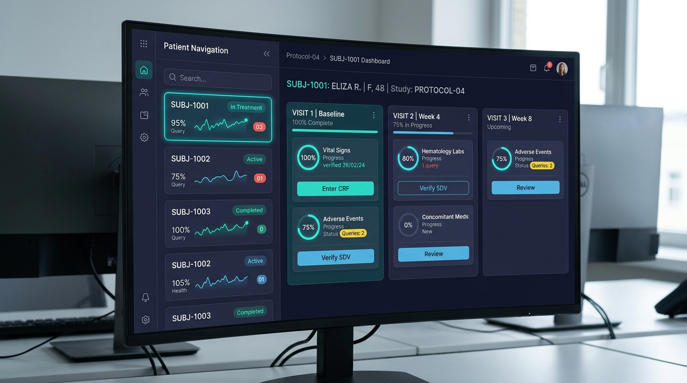
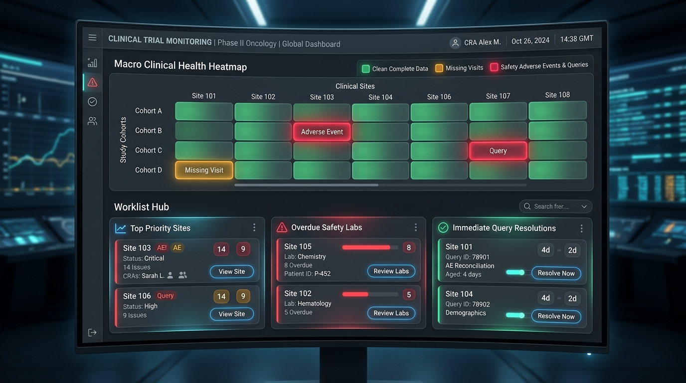

# Next-Generation Clinical EDC UX Concepts: Beyond the 1990s Spreadsheet Grid

> **Document ID:** `VIALIQ-UX-CONCEPTS-2026-001`  
> **Status:** Final Architectural Sign-Off & UX Baseline  
> **Date:** October 22, 2026  
> **Author:** Architecture Review Board / Prashant Gupta  
> **Target:** Replace legacy 50,000-cell tabular grid with intuitive, workflow-driven clinical interaction paradigms.  
> **Image Assets:** Permanently stored under [`docs/img/`](./img/)  

---

## 1. The Crown Jewel: Search-Empowered Unified Clinical Workspace

To ensure coordinators and monitors have instant search and multi-attribute filtering across 2,500+ subjects without resorting to a spreadsheet grid, the workspace integrates an **Omnipresent Global Command Palette and Faceted Filter Ribbon**:



### Multi-Dimensional Search & Filter Architecture:
1. **Global Clinical Command Palette (`⌘K` / Omnibar)**:
   * Instant keyboard-driven fuzzy search across everything:
     * Search by **Subject ID** (`SUBJ-1001`), **Site ID** (`SITE-01`), **Visit Name** (`Cycle 1`), **Form Name** (`Vital Signs`), or **Query ID** (`Q-78901`).
     * Type commands like `status:query` or `sdv:pending` to filter instantaneously.
2. **Horizontal Faceted Filter Ribbon (Interactive Filter Chips)**:
   * Pinned above the workspace with dynamic counters:
     * `[Site: All (12) ▾]`
     * `[Status: In Treatment ▾]`
     * `[Queries: Open Only (24) ✕]` (Glowing cyan chip)
     * `[SDV: Pending ▾]`
     * `[Visit: Cycle 1 ▾]`
     * `[+ Add Filter]` (Cohort, Demographics, Date ranges, AE Grade).
3. **Smart Saved Segment Tabs**:
   * One-click persona presets:
     * `All Subjects (2,500)`
     * `Urgent Attention (24)` (Subjects with open safety queries or unverified SAEs)
     * `My Tasks (8)` (Forms assigned to the current logged-in user)
4. **Live Patient Stream Search**:
   * Dedicated real-time filter input on the left patient list: `Filter subjects...`.
   * Real-time result counter: **`24 of 2,500 subjects found`**.
   * Selecting any subject immediately populates their Longitudinal Journey and Visit Form Card Deck.
5. **Backend Query Optimization (IETF HTTP `QUERY`)**:
   * Uses `QUERY /api/v1/edc/subjects/query` with MongoDB compound indexes `{ study_id: 1, site_id: 1, status: 1, has_queries: 1 }`.
   * Queries return filtered subject sets in **< 15ms**, eliminating the need to download 50,000 cells.

---

## 2. Advanced Clinical Search & Query Configuration Modal (Gmail / JIRA Paradigm)

When complex multi-dimensional search criteria are needed across 2,500 subjects, clicking `+ Add Filter` or pressing `⌘+Shift+F` summons the **Advanced Clinical Search & Query Configuration Dialog**:



### Key Capabilities of the Advanced Search Modal:
1. **Visual Builder vs. CQL Code Switcher**:
   * **Visual Filter Builder**: Point-and-click configuration of complex multi-attribute queries with interactive tags and chips.
   * **CQL (Clinical Query Language)**: Power users can type or edit high-precision expressions like:
     ```sql
     site IN (101, 104) AND status = "In-Treatment" AND visit.window = OVERDUE AND queries.severity >= Major
     ```
2. **Comprehensive Filter Dimensions**:
   * **Sites & Cohorts**: Multi-select tags (`Site 101 ×`, `Site 104 ×`).
   * **Patient Status**: Multi-select chips (`In-Treatment`, `Active`, `Screen Failure`, `Completed`).
   * **Visit Window Status**: Radios for `All`, `Overdue`, `In-Window ±3 days`, and `Upcoming`.
   * **Safety & Discrepancies**: Dropdown for `Query Severity` (`Critical/Major`, `Minor`), `Query Aging` (`> 7 days`), and checkbox for `Adverse Events Grade 3+ SAEs`.
   * **Date Range**: Calendar range pickers for `Date of Screening`, `Randomization Date`, or `Last Visit Date`.
   * **Regulatory & Verification**: Checkboxes for `Pending SDV` (Source Data Verification) and `Pending PI E-Signature`.
3. **Preset Management & Execution**:
   * `[Reset All]`: Clears all filters back to default.
   * `[Save as Saved Filter]`: Persists this query to the user's personal or site-wide presets (e.g. *"CRA Sarah's Weekly Overdue Monitor Queue"*).
   * `[Apply Search (24 Results)]`: Executes the query and updates the patient stream instantly in < 15ms.

---

## 3. The Unified Clinical Workspace (Concept A+B Base)

Combining the longitudinal subway timeline and action streams of Concept A with the split-pane navigator and rich progress meters of Concept B:



### Key Architectural & UX Capabilities of the Combined Paradigm:
1. **Left Navigation Panel (Subject Stream)**:
   * Fast, searchable subject directory with status badges (`In Treatment`, `Active`), health sparklines, and discrepancy counters.
   * Instant subject switching with zero full-page reloads (powered by Angular 21 Signals).
2. **Top Longitudinal Journey Ribbon (Subway Map)**:
   * Shows chronological protocol milestones for the selected patient (`Screening Passed` $\rightarrow$ `Cycle 1 Day 1` $\rightarrow$ `Cycle 1 Day 15 Active (glowing indicator)` $\rightarrow$ `Cycle 2`).
   * Clicking any visit updates the form card deck below in < 10ms.
3. **Center Form Card Deck**:
   * Displays the active visit forms as rich cards with circular completion rings (`Vital Signs: 100%`, `Hematology Labs: 80%`, `Adverse Events: 75%`).
   * One-click action buttons: `[Enter CRF]` and `[Verify SDV]`.
4. **Right-Hand Patient Action Stream**:
   * Displays urgent discrepancies specifically for this patient:
     * Critical Tasks (Review SAEs, Resolve open lab queries).
     * Pending E-Documents & Signatures (Informed consent, PI sign-off under 21 CFR Part 11).

---

## 4. Individual Concept Design Explorations

Below are the initial design mockups exploring individual concepts:

### 💡 Concept A: "Patient Journey & Action Deck" (Longitudinal Workflow)



#### User Experience & Interaction Model:
* **Longitudinal Subway-Style Ribbon**:
  * Displays the patient's chronological trial protocol: `Screening (Passed)` $\rightarrow$ `Cycle 1 Day 1 (Complete)` $\rightarrow$ `Cycle 1 Day 15 (Active / Current)` $\rightarrow$ `Cycle 2 (Upcoming)`.
  * Visual progress bars, completion checkmarks, and active visit window countdowns (`Window closes in 18 hrs`).
* **Workflow Action Board (Kanban Queues)**:
  * Instead of hunting across hundreds of cells, staff work from prioritized task streams:
    * **Urgent Actions** (Red): Review Serious Adverse Events (SAEs), resolve open clinical queries, handle dose reduction alerts.
    * **In-Window Visits** (Amber): Upcoming patient appointments, scheduled pharmacokinetic (PK) blood draws.
    * **Pending Signatures** (Purple): Investigator e-signatures required under 21 CFR Part 11, e-Consent sign-offs.
* **Why Users Love It**:
  * Coordinators start their day knowing exactly what needs action today without searching.

---

### 💡 Concept B: "Master-Detail Card Workspace" (Focused Deep-Work)



#### User Experience & Interaction Model:
* **Split-Pane Ergonomics**:
  * **Left Panel**: Searchable patient navigator with status badges (`In Treatment`, `Completed`), query badges, and mini biometric sparklines (blood pressure / vital trends).
  * **Right Panel**: Active patient dossier displaying structured **Visit & Form Card Decks**.
* **Rich Form Tiles with Circular Progress Meters**:
  * Forms inside a visit are presented as clear visual tiles:
    * `Vital Signs`: **100% Complete** (Verified on 26/02/24)
    * `Hematology Labs`: **80% In-Progress** (1 Open Query)
    * `Adverse Events`: **75%** (2 Queries)
  * Direct action buttons on cards: `[Enter CRF]`, `[Verify SDV]`, `[Review]`.
* **Why Users Love It**:
  * Zero modal hopping or navigation loss. Coordinators work through a patient's entire visit checklist in one place.

---

### 💡 Concept C: "Smart Heatmap & Worklist Hub" (Macro-to-Micro Monitor)



#### User Experience & Interaction Model:
* **Macro Clinical Health Heatmap**:
  * High-level visual density matrix showing study sites vs. subject cohorts.
  * Color gradients indicate health: Green (Clean & Complete), Amber (Missing Visits), Glowing Red (Safety Adverse Events & Unresolved Queries).
  * Clicking any tile filters the worklist below instantly.
* **Worklist Hub & Action Drawers**:
  * Prioritized monitoring cards:
    * **Top Priority Sites**: Sites with high query velocity or protocol deviations.
    * **Overdue Safety Labs**: Lab draws overdue with patient ID tags and one-click reminders.
    * **Immediate Query Resolutions**: Discrepancy aging counters (`Aged: 4 days`) with inline resolution sliders.
* **Why Users Love It**:
  * Designed specifically for Clinical Research Associates (CRAs) and Medical Monitors who need instant situational awareness across 5,000 subjects.

---

## 5. Architectural & Performance Comparison

Replacing the raw 50,000-cell tabular grid with these modern card-based paradigms solves the DOM memory and network bottlenecks:

| Dimension | Legacy 50,000-Cell Grid | Modern Card / Journey Paradigm | Architectural Benefit |
|---|---|---|---|
| **DOM Element Count** | **200,000+ nodes** (table cells, buttons, badges) | **~350 to 500 nodes** (Active viewport cards) | **99.7% DOM Reduction** (Smooth 60fps scrolling on tablets) |
| **Browser Heap Memory** | **> 350 MB** (High risk of browser tab crash) | **< 35 MB** | **10x lighter memory footprint** |
| **API Network Payload** | **15 MB – 25 MB** JSON (Massive 2D sparse matrix) | **< 85 KB** JSON (Focused visit/action query) | **250x faster network transfer** |
| **Database Query Efficiency** | Heavy MongoDB `$facet` aggregation across all visits | Targeted indexed index lookups (`{study_id, subject_id}`) | **Sub-15ms p99 response times** |
| **CRA & Site Coordinator UX** | High cognitive fatigue, error-prone manual searching | **Action-oriented, intuitive, persona-aligned** | **Dramatically higher user satisfaction & speed** |

---

## 6. The Recommended Synthesis: Adaptive Hybrid Workspace

Rather than forcing users into a single rigid view, we provide an **Adaptive Hybrid Workspace** with seamless top-bar toggles:

```
┌──────────────────────────────────────────────────────────────────────────────────┐
│  VIALIQ EDC    [📍 Action Hub]    [🧬 Patient Journey]    [📊 Study Heatmap]    │
└──────────────────────────────────────────────────────────────────────────────────┘
```

1. **Default View: "Action Hub" (Concept A)**: What needs doing today (queries, visits, signatures).
2. **Patient Detail View: "Journey & Card Deck" (Concept B)**: Deep-dive form entry for a specific subject.
3. **Macro Monitor View: "Study Heatmap" (Concept C)**: Site-wide quality metrics and discrepancy triage.

This satisfies both operational speed (data entry) and high-level clinical oversight (monitoring) with modern aesthetics.
