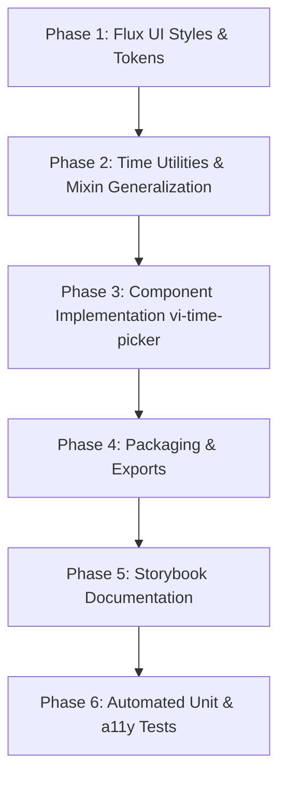

# `vi-time-picker` — Time Picker Design & Architecture Specification

**Package:** `@vialiq/web-components/time-picker`  
**Element:** `<vi-time-picker>`  
**Status:** 🏗️ In Planning & Implementation  
**Flux UI base:** `libs/flux-ui/components/_time-picker.scss` & `libs/flux-ui/styles/_flatpickr.scss` (shared tokens)  
**Engine:** [flatpickr](https://flatpickr.js.org/) — `enableTime: true`, `noCalendar: true` (MIT, zero-runtime-dependencies)  
**Reference Standards:** [`CSS-DESIGN-SYSTEM.md`](../CSS-DESIGN-SYSTEM.md), [`vi-date-picker.md`](./vi-date-picker.md), CDISC SDTM Clinical EDC Standards

---

## Table of Contents

1. [Purpose & Clinical Context](#1-purpose--clinical-context)
2. [Architectural Analysis & Learnings from vi-date-picker](#2-architectural-analysis--learnings-from-vi-date-picker)
3. [12-Hour vs. 24-Hour Format Architecture](#3-12-hour-vs-24-hour-format-architecture)
4. [Dual-Input Interaction Architecture](#4-dual-input-interaction-architecture)
5. [Public API Contract](#5-public-api-contract)
6. [Style Architecture & Flux UI vs. Web Component Boundaries](#6-style-architecture--flux-ui-vs-web-component-boundaries)
7. [Flatpickr Engine Configuration & Flux UI Styling](#7-flatpickr-engine-configuration--flux-ui-styling)
8. [Keyboard Interactions & Accessibility (a11y)](#8-keyboard-interactions--accessibility-a11y)
9. [Clinical EDC & Unknown Time (CDISC SDTM)](#9-clinical-edc--unknown-time-cdisc-sdtm)
10. [Form Association & Validation (WHATWG)](#10-form-association--validation-whatwg)
11. [Usage Examples](#11-usage-examples)
12. [Step-by-Step Implementation & Testing Plan](#12-step-by-step-implementation--testing-plan)

---

## 1. Purpose & Clinical Context

A form-associated, accessible time-of-day entry control engineered for clinical Electronic Data Capture (EDC) as well as general-purpose enterprise web applications.

In clinical trials, time capture has stringent requirements:
- **High-speed discrete data entry:** Coordinators and data entry staff frequently enter dozens of precise time values per case report form (CRF), requiring immediate keyboard entry without mandatory mouse clicks.
- **Protocol time constraints:** Enforcing infusion start/stop times, dose schedules, and vital sign assessment intervals (`min`, `max`, and `step`).
- **CDISC SDTM Partial/Unknown Time:** Protocols regularly encounter unrecorded or unknown times (e.g. adverse event onset times reported by a subject as "sometime in the evening"), which must be standardized as `??:??` or `??:??:??` without failing numeric validation.
- **12-Hour vs. 24-Hour Internationalization:** Native support for both 24-hour military/scientific clocks and localized 12-hour AM/PM formats.

### Relationship to `vi-date-picker`
- Use `vi-time-picker` when only the time of day is required.
- Use `vi-date-picker` for date-only capture.
- When both date and time must be captured within a single consolidated field, `vi-date-picker` provides date selection with flatpickr time extension.

---

## 2. Architectural Analysis & Learnings from `vi-date-picker`

`vi-date-picker` established key architectural solutions in the `@vialiq/web-components` codebase. `vi-time-picker` builds directly on these proven patterns:

```
┌─────────────────────────────────────────────────────────────────────────────┐
│                          ViElement (Base Web Component)                     │
└──────────────────────────────────────┬──────────────────────────────────────┘
                                       │
┌──────────────────────────────────────▼──────────────────────────────────────┐
│                  ValidityMixin (WHATWG Form Participation)                  │
│       • ElementInternals (_internals.setFormValue, setValidity)             │
│       • checkValidity(), reportValidity(), setCustomValidity()              │
│       • Form lifecycle: formResetCallback(), formDisabledCallback()         │
└──────────────────────────────────────┬──────────────────────────────────────┘
                                       │
┌──────────────────────────────────────▼──────────────────────────────────────┐
│                    FlatpickrMixin (Engine Lifecycle Host)                   │
│       • Dynamic async loading of flatpickr library                          │
│       • Parallel resolution of locales and plugins                          │
│       • Instance mount, re-init generation tracking, clean destruction      │
└──────────────────────────────────────┬──────────────────────────────────────┘
                                       │
┌──────────────────────────────────────▼──────────────────────────────────────┐
│                                ViTimePicker                                 │
│       • Dual-input UI: Segmented numeric inputs + Popup trigger             │
│       • FloatingController: @floating-ui positioning + hoist support         │
│       • ViShadowDomPlugin: Shadow DOM event traversal for popup             │
│       • Clinical CDISC SDTM unknown time support                            │
└─────────────────────────────────────────────────────────────────────────────┘
```

### 2.1 Base Class Composition
`ViTimePicker` inherits:
```typescript
export class ViTimePicker extends ValidityMixin(FlatpickrMixin(ViElement))
```
- **`ValidityMixin`**: Grants full form participation (`static formAssociated = true`), native form submissions via `_internals.setFormValue()`, visual state reflection (`status="default|valid|invalid"`), and validation message display.
- **`FlatpickrMixin`**: Provides an abstract lifecycle for initializing Flatpickr over a hidden `<input id="fp-input">` element, canceling obsolete initialization generations, and destroying instances on disconnect.

### 2.2 Popup Anchoring with `FloatingController`
Flatpickr's built-in position calculation is unaware of Shadow DOM boundaries and CSS transforms. Following `vi-date-picker`, `vi-time-picker` utilizes `FloatingController`:
- References the clock button (`_clockBtn`) or control row as the anchor.
- References `this._fp?.calendarContainer` as the floating element.
- Provides `hoist` support: When `hoist` is enabled, the popup uses `position: fixed` and registers with `OverlayManager` to escape tight `overflow: hidden` parent containers (e.g. within modals or table cells).
- Automatically manages placement flips (`bottom-start` to `top-start`) and viewport offset.

### 2.3 Shadow DOM Event Boundary Handling (`ViShadowDomPlugin`)
Flatpickr registers a global `documentClick` listener relying on native `Node.contains()`. Native `contains()` does not pierce Shadow DOM boundaries; clicks on elements inside the component's shadow root are mistakenly identified as outside clicks, causing Flatpickr to close unexpectedly.
- `vi-time-picker` includes `ViShadowDomPlugin`, which overrides `calendarContainer.contains` to traverse up through Shadow Roots (`node.getRootNode().host`).

---

## 3. 12-Hour vs. 24-Hour Format Architecture

The component natively supports both 12-hour and 24-hour time representations via the `format` property (`format="12"` | `format="24"`, default `'24'`).

```
┌──────────────────────────────────────────────────────────────────────────────────────────────┐
│ 24-Hour Mode (format="24", default)                                                          │
│ ┌──────────────────────────────────────────────────────────────────────────────────────────┐ │
│ │  [ 14 ] : [ 30 ]  [ 🕒 ]                                                                 │ │
│ └──────────────────────────────────────────────────────────────────────────────────────────┘ │
│ • Hours: 00 - 23 (2 digits, padded)                                                          │
│ • No AM/PM period button rendered                                                            │
│ • Flatpickr engine: time_24hr = true                                                         │
│ • Serialized / Submitted Value: "14:30" (or "14:30:00")                                      │
├──────────────────────────────────────────────────────────────────────────────────────────────┤
│ 12-Hour Mode (format="12")                                                                   │
│ ┌──────────────────────────────────────────────────────────────────────────────────────────┐ │
│ │  [ 02 ] : [ 30 ]  [ PM ]  [ 🕒 ]                                                         │ │
│ └──────────────────────────────────────────────────────────────────────────────────────────┘ │
│ • Hours: 01 - 12                                                                             │
│ • Interactive AM/PM period button (button[part="period-btn"])                                │
│ • Keyboard shortcuts: Pressing 'A'/'a' sets AM, pressing 'P'/'p' sets PM                     │
│ • Flatpickr engine: time_24hr = false (shows .flatpickr-am-pm toggle)                        │
│ • Display Value: "02:30 PM" (or "02:30:00 PM")                                               │
│ • Normalized isoValue: Always converts to 24h ("14:30") for standard backend interoperability│
└──────────────────────────────────────────────────────────────────────────────────────────────┘
```

### 3.1 24-Hour Clock (`format="24"`)
- **Hours Range:** `00` through `23`.
- **Keyboard Bounds:** Typing numbers outside `00-23` clamps or moves focus as appropriate.
- **Period Button:** Omitted from the DOM entirely.
- **Flatpickr Engine:** Configured with `time_24hr: true`.
- **Event detail:** `period` is `null`.

### 3.2 12-Hour Clock (`format="12"`)
- **Hours Range:** `01` through `12`.
- **Period Button:** Rendered with `part="period-btn"`. Displays `AM` or `PM`. Clicking it toggles between AM and PM.
- **Keyboard Shortcuts:**
  - When focused on `hours-input` or `period-btn`, pressing key `A` or `a` sets the period to `AM`.
  - Pressing key `P` or `p` sets the period to `PM`.
- **Flatpickr Engine:** Configured with `time_24hr: false`. Flatpickr's popup automatically renders the `.flatpickr-am-pm` toggle button.
- **Value Synchronization & Normalization:**
  - `value`: reflects the 12-hour formatted time (e.g. `02:30 PM`).
  - `isoValue`: provides the standardized 24-hour ISO representation (e.g. `14:30`), ensuring backend APIs receive consistent time representations regardless of UI display mode.
  - `period`: emitted as `'AM'` or `'PM'` in `TimePickerChangeDetail`.

---

## 4. Dual-Input Interaction Architecture

To maximize efficiency, `<vi-time-picker>` implements a hybrid interaction model:

```
vi-time-picker (Shadow DOM)
├── div[part="control"] .timepicker-control
│   ├── div.timepicker-inputs
│   │   ├── input[part="hours-input"].timepicker-segment   - Numeric 2-digit input (HH)
│   │   ├── span[part="separator"].timepicker-separator    - ":" separator
│   │   ├── input[part="minutes-input"].timepicker-segment - Numeric 2-digit input (mm)
│   │   ├── span[part="separator"].timepicker-separator    - ":" separator (when show-seconds)
│   │   └── input[part="seconds-input"].timepicker-segment - Numeric 2-digit input (ss, optional)
│   ├── button[part="period-btn"].timepicker-period-btn    - "AM" / "PM" toggle (12-hour format only)
│   ├── button[part="clock-btn"].timepicker-clock-btn      - Clock icon button (opens flatpickr scroll popup)
│   └── button[part="clear-btn"].timepicker-clear-btn      - Clear "×" button (when clearable & value present)
├── input#fp-input[type="hidden"]                          - Hidden input bound to Flatpickr engine
├── div[part="unknown-wrapper"].timepicker-unknown-wrapper - "Time unknown" checkbox (when allow-unknown)
│   ├── input#unknown-checkbox
│   └── label
├── div#floating-menu-container                            - Anchored popup target for Flatpickr container
├── slot[name="helper"]                                    - Persistent helper text slot
└── span[part="validation"].validity-msg                   - Validation error message container
```

### 4.1 Segmented Keyboard Workflow
1. **Direct Numeric Entry:**
   - User tabs into the `hours-input` (placeholder `HH`).
   - User types a digit (e.g. `1` then `4`). Once 2 valid digits are entered, focus automatically jumps to `minutes-input`.
   - User types `3` then `0`. If seconds are enabled, focus moves to `seconds-input`; otherwise, the value is committed.
2. **Colon / Tab Navigation:**
   - Pressing `:` or `Tab` within `hours-input` immediately advances focus to `minutes-input`.
   - Pressing `Backspace` in an empty `minutes-input` jumps focus back to `hours-input`.
3. **Keyboard Increment / Decrement:**
   - Pressing `ArrowUp` or `ArrowDown` increments/decrements the active segment.
   - Minutes step according to the configured `step` property (default: `15`). Hours step by `1`.
   - In 12-hour format, pressing `A` or `P` toggles between AM and PM.

### 4.2 Graphical Scroll Popup
- Clicking the clock button (`part="clock-btn"`) opens Flatpickr's time scroll wheels (`.flatpickr-time`).
- Scrolling the wheel or clicking Flatpickr's arrows immediately synchronizes the segmented inputs and vice-versa.
- Pressing `Escape` or clicking outside cleanly dismisses the popup and restores focus to the clock trigger.

---

## 5. Public API Contract

### 5.1 Properties & Attributes

| Property | Attribute | Type | Default | Reflects | Description |
|---|---|---|---|---|---|
| `value` | `value` | `string` | `''` | ✅ | `HH:mm` or `HH:mm:ss`, `hh:mm A`, or `??:??` when unknown |
| `name` | `name` | `string` | `''` | — | Form field name for native form submission |
| `format` | `format` | `'12' \| '24'` | `'24'` | ✅ | 12-hour or 24-hour time clock |
| `step` | `step` | `number` | `15` | — | Minute step increment (`1`, `5`, `10`, `15`, `30`) |
| `hourStep` | `hour-step` | `number` | `1` | — | Hour step increment (`1`, `2`, `4`) |
| `secondStep` | `second-step` | `number` | `1` | — | Second step increment (`1`, `5`, `10`) |
| `showSeconds` | `show-seconds` | `boolean` | `false` | — | Enables seconds segment (`HH:mm:ss` / `hh:mm:ss A`) |
| `showNow` | `show-now` | `boolean` | `false` | — | Displays quick "Now" current timestamp action button |
| `timezone` | `timezone` | `string` | `''` | ✅ | Timezone context badge and ISO offset indicator (e.g. `'UTC'`, `'EST'`, `'+05:30'`) |
| `min` | `min` | `string` | `''` | — | Minimum selectable time (`HH:mm` or `HH:mm:ss`) |
| `max` | `max` | `string` | `''` | — | Maximum selectable time (`HH:mm` or `HH:mm:ss`) |
| `disabled` | `disabled` | `boolean` | `false` | ✅ | Disables all interactions |
| `disabledHours`| — | `number[] \| DisabledHoursFn` | `null` | — | Blackout hours list or predicate function `(h: number) => boolean` |
| `disabledMinutes`| — | `number[] \| DisabledMinutesFn` | `null` | — | Blackout minutes list or predicate function `(m: number, h?: number) => boolean` |
| `disabledSeconds`| — | `number[] \| DisabledSecondsFn` | `null` | — | Blackout seconds list or predicate function `(s: number, m?: number, h?: number) => boolean` |
| `required` | `required` | `boolean` | `false` | ✅ | Marks the field as required |
| `readonly` | `readonly` | `boolean` | `false` | ✅ | Value cannot be edited but is submitted |
| `allowUnknown` | `allow-unknown` | `boolean` | `false` | — | Enables clinical "Time unknown" (`??:??` / `14:??`) mode with indeterminate checkbox state |
| `hoist` | `hoist` | `boolean` | `false` | — | Hoists popup via fixed positioning to escape overflow |
| `status` | `status` | `ControlStatus` | `'default'` | ✅ | Visual validation status (`default`, `valid`, `invalid`) |
| `validityMessage` | `validity-message`| `string` | `''` | — | Error or validation feedback message |
| `locale` | `locale` | `string \| null` | `null` | — | BCP 47 locale tag (e.g. `'fr'`, `'de'`, `'es'`) for localized flatpickr and defaults |
| `config` | `config` | `Partial<TimePickerConfig>` | `{}` | — | Unified configuration object for placeholders, labels, and messages (reactive with Proxy watching) |
| `i18n` | `i18n` | `Partial<TimePickerI18n>` | `{}` | — | Alias for `config`, supporting internationalization terminology |

> **Configuration Object & Reactivity:** Instead of cluttering the component with dozens of individual string properties, consumers pass a configuration object via `.config` or `.i18n` (or use `el.setConfig({ ... })`). The component wraps the configuration object in a reactive `Proxy`, so in-place mutations (e.g. `el.config.unknownLabel = 'Custom'`) are automatically intercepted, re-validating the component and updating the rendered DOM immediately.

> **Browser Autocomplete:** All segmented numeric inputs (`#hours-input`, `#minutes-input`, `#seconds-input`) are configured with `autocomplete="off"`, `autocorrect="off"`, `autocapitalize="off"`, and `spellcheck="false"` to prevent browser autofill popups or mobile predictive text from obstructing the time controls.

### 5.2 TypeScript Types

```typescript
export type TimeFormat = '12' | '24';
export type ControlStatus = 'default' | 'valid' | 'invalid';

export interface TimeComponents {
  hours: number | null;
  minutes: number | null;
  seconds?: number | null;
  period?: 'AM' | 'PM';
  rawHours?: string;
  rawMinutes?: string;
  rawSeconds?: string;
  isPartial?: boolean;
}

export type DisabledHoursFn = (hour: number) => boolean;
export type DisabledMinutesFn = (minute: number, hour?: number) => boolean;
export type DisabledSecondsFn = (second: number, minute?: number, hour?: number) => boolean;

export interface TimePickerChangeDetail {
  /** The value string: "14:30", "02:30 PM", or "??:??" */
  value: string | null;
  /** Normalized 24-hour string: "14:30" or "14:30:00" */
  isoValue: string | null;
  /** Parsed numeric hours (0-23 in 24h, 1-12 in 12h) */
  hours: number | null;
  /** Parsed numeric minutes (0-59) */
  minutes: number | null;
  /** Parsed numeric seconds (0-59, if enabled) */
  seconds?: number | null;
  /** Active period in 12-hour format ('AM' | 'PM' | null) */
  period?: 'AM' | 'PM' | null;
  /** True when marked as unknown ("??:??") */
  isUnknown: boolean;
  /** Localized display string */
  formattedValue: string;
}
```

### 5.3 Events

| Event Name | Type | Bubbles | Composed | Description |
|---|---|---|---|---|
| `vi-time-picker-change` | `CustomEvent<TimePickerChangeDetail>` | ✅ | ✅ | Dispatched whenever the committed time value changes |
| `vialiq-change` | `CustomEvent<TimePickerChangeDetail>` | ✅ | ✅ | Legacy alias for backwards compatibility |
| `vialiq-clear` | `CustomEvent<void>` | ✅ | ✅ | Dispatched when the clear button is clicked |
| `invalid` | `Event` (cancelable) | ❌ | ❌ | Dispatched when form constraint validation fails |

### 5.4 Imperative Methods

- `focus(options?: FocusOptions)`: Focuses the hours segment.
- `clear()`: Clears the value, resets Flatpickr, and dispatches change events.
- `open()`: Programmatically opens the Flatpickr scroll popup.
- `close()`: Programmatically closes the Flatpickr scroll popup.
- `stepUp(segment?: 'hours' | 'minutes' | 'seconds')`: Increments the specified segment by its step.
- `stepDown(segment?: 'hours' | 'minutes' | 'seconds')`: Decrements the specified segment by its step.
- `checkValidity()`: Returns `true` if valid; does not alter visual state.
- `reportValidity()`: Validates, updates visual `status`, and triggers native validation feedback.
- `setCustomValidity(message: string)`: Sets a custom validation error message.

---

## 6. Style Architecture & Flux UI vs. Web Component Boundaries

To maintain clean modularity and reusability across frameworks and plain HTML consumers, styling responsibilities are strictly separated:

```
┌────────────────────────────────────────────────────────────────────────────────────────┐
│ libs/flux-ui (Shared Component Foundation)                                             │
├────────────────────────────────────────────────────────────────────────────────────────┤
│ 1. libs/flux-ui/components/_time-picker.scss (@layer components)                       │
│    • .timepicker-control       (outer container, borders, background, radius, height)   │
│    • .timepicker-inputs        (flex row of numeric inputs)                             │
│    • .timepicker-segment       (hours/minutes/seconds input reset, font, text-align)    │
│    • .timepicker-separator     (colon : styles)                                         │
│    • .timepicker-period-btn    (AM/PM toggle button styles, active/hover states)        │
│    • .timepicker-clock-btn     (action button, icon alignment)                          │
│    • .timepicker-clear-btn     (clear button, icon alignment)                           │
│    • .timepicker-unknown-wrapper (checkbox, label typography)                           │
│    • .validity-msg             (validation message text styling)                        │
│                                                                                        │
│ 2. libs/flux-ui/styles/_flatpickr.scss                                                 │
│    • .flatpickr-calendar.hasTime.noCalendar (popup container, elevation, shadow)       │
│    • .flatpickr-time           (scroll wheels, inputs, arrows, separators, AM/PM)       │
└────────────────────────────────────────────────────────────────────────────────────────┘
                                           ▲
                                           │ imported by
┌──────────────────────────────────────────┴─────────────────────────────────────────────┐
│ libs/web-components (Custom Element Layer)                                             │
├────────────────────────────────────────────────────────────────────────────────────────┤
│ libs/web-components/src/time-picker/vi-time-picker.scss                                 │
│    • :host                     (display, font-family, CSS token variable defaults)     │
│    • :host([disabled])         (disabled opacity and cursor)                           │
│    • :host([status="invalid"]) (invalid border token override)                         │
│    • :host([status="valid"])   (valid border token override)                           │
│    • :host([readonly])         (readonly state cursor)                                 │
│    • ::slotted([slot="helper"])(slotted helper text layout)                            │
│    • #fp-input                 (hidden input positioning)                              │
│    • #floating-menu-container  (popup positioning anchor)                              │
└────────────────────────────────────────────────────────────────────────────────────────┘
```

> **Architecture Principle:** All styles that are **not slotted or on host** live in **Flux UI**. The Web Component's Shadow DOM SCSS file (`vi-time-picker.scss`) imports `@use '@vialiq/flux-ui/components/time-picker'` and `@use '@vialiq/flux-ui/styles/flatpickr'`, defining only `:host` states, slotted styles, and token fallbacks.

### 6.1 Three-Level Cascade Strategy ([`CSS-DESIGN-SYSTEM.md`](../CSS-DESIGN-SYSTEM.md))

```scss
// Level 1: Consumer override
// Level 2: Semantic Flux UI token
// Level 3: Compile-time SASS variable fallback
border-color: var(
  --vi-time-picker-border-color,
  var(--vi-border-03, #{tokens.$border-03})
);
```

### 6.2 CSS Custom Properties

| Token | Semantic Fallback | SASS Fallback | Description |
|---|---|---|---|
| `--vi-time-picker-border-color` | `--vi-border-03` | `tokens.$border-03` | Input resting border color |
| `--vi-time-picker-border-color-hover` | `--vi-border-04` | `tokens.$border-04` | Input hover border color |
| `--vi-time-picker-focus-ring-color` | `--vi-focus` | `tokens.$focus` | Focus outline ring color |
| `--vi-time-picker-focus-ring-glow` | `--vi-color-blue-200` | `tokens.$color-blue-200`| Focus glow shadow |
| `--vi-time-picker-background-color` | `--vi-color-background`| `tokens.$color-background`| Field background color |
| `--vi-time-picker-text-color` | `--vi-text-primary` | `tokens.$text-primary` | Typed segment text color |
| `--vi-time-picker-placeholder-color`| `--vi-text-secondary` | `tokens.$text-secondary` | Segment placeholder color |
| `--vi-time-picker-separator-color` | `--vi-text-secondary` | `tokens.$text-secondary` | Colon `:` separator color |
| `--vi-time-picker-error-color` | `--vi-color-error` | `tokens.$color-error` | Error border & text color |
| `--vi-time-picker-success-color` | `--vi-color-success` | `tokens.$color-success` | Success border color |
| `--vi-time-picker-shape-border-radius`| `--vi-border-radius-lg`| `tokens.$border-radius-lg`| Field corner radius (`8px`) |
| `--vi-time-picker-sizing-min-height` | — | `40px` | Standard field height |
| `--vi-time-picker-segment-width` | — | `36px` | Width per numeric segment input |
| `--vi-time-picker-period-width` | — | `52px` | Width for AM/PM toggle button |
| `--vi-time-picker-popup-bg` | `--vi-layer-01` | `tokens.$layer-01` | Popup background color |
| `--vi-time-picker-popup-shadow` | `--vi-shadow-lg` | `tokens.$shadow-lg` | Popup elevation shadow |
| `--vi-time-picker-popup-border` | `--vi-border-03` | `tokens.$border-03` | Popup border outline |

### 6.3 CSS Parts (`::part()`)

| Part | Element | Description |
|---|---|---|
| `control` | Outer `<div>` | Outer container holding segments and buttons |
| `hours-input` | `<input>` | Hours numeric input |
| `minutes-input` | `<input>` | Minutes numeric input |
| `seconds-input` | `<input>` | Seconds numeric input (when `show-seconds`) |
| `separator` | `<span>` | Colon `:` separator elements |
| `period-btn` | `<button>` | AM/PM toggle button |
| `clock-btn` | `<button>` | Clock popup trigger button |
| `clear-btn` | `<button>` | Clear button |
| `popup` | `<div>` | Floating container for Flatpickr popup |
| `unknown-wrapper` | `<div>` | Container for the "Time unknown" checkbox |
| `unknown-checkbox`| `<input>` | The "Time unknown" checkbox element |
| `helper` | `<div>` | Slotted helper text wrapper |
| `validation` | `<span>` | Validation error message element |

---

## 7. Flatpickr Engine Configuration & Flux UI Styling

### 7.1 Flatpickr Time Configuration
Flatpickr is mounted on the hidden `<input id="fp-input">`:
```typescript
const fpConfig: Partial<Options> = {
  enableTime: true,
  noCalendar: true,
  time_24hr: this.format === '24',
  minuteIncrement: this.step,
  enableSeconds: this.showSeconds,
  minTime: this.min || undefined,
  maxTime: this.max || undefined,
  dateFormat: this.format === '24'
    ? (this.showSeconds ? 'H:i:S' : 'H:i')
    : (this.showSeconds ? 'h:i:S K' : 'h:i K'),
  disableMobile: true,
  clickOpens: false,
  appendTo: this._floatingMenuContainer,
  plugins: [ViShadowDomPlugin()],
  onChange: (selectedDates: Date[], dateStr: string) => {
    this._handleFlatpickrChange(selectedDates[0], dateStr);
  },
  onOpen: () => {
    this._floatingController.start();
  },
  onClose: () => {
    this._floatingController.stop();
  },
};
```

### 7.2 Flux UI Token Styling (`libs/flux-ui/styles/_flatpickr.scss`)
To ensure the popup matches the rest of the Vialiq design system, `_flatpickr.scss` provides dedicated `.flatpickr-time` styling:
```scss
// ----------------------------------------------------------------------------
// Time Picker Styles (.flatpickr-time)
// ----------------------------------------------------------------------------
.flatpickr-calendar.hasTime.noCalendar {
  background: var(--vi-time-picker-popup-bg, var(--vi-layer-01, tokens.$layer-01));
  box-shadow: var(--vi-time-picker-popup-shadow, var(--vi-shadow-lg, tokens.$shadow-lg));
  border: 1px solid var(--vi-time-picker-popup-border, var(--vi-border-03, tokens.$border-03));
  border-radius: var(--vi-border-radius-lg, tokens.$border-radius-lg);
  padding: var(--vi-spacing-xs, tokens.$spacing-xs);
  width: auto;
}

.flatpickr-time {
  height: 40px;
  line-height: 40px;
  display: flex;
  align-items: center;
  gap: 2px;

  .numInputWrapper {
    height: 36px;
    border-radius: var(--vi-border-radius-md, tokens.$border-radius-md);

    input {
      color: var(--vi-time-picker-text-color, tokens.$text-primary);
      font-size: var(--vi-font-size-base, tokens.$font-size-base);
      font-family: var(--vi-font-family-base, tokens.$font-family-base);
      font-weight: var(--vi-font-weight-semibold, tokens.$font-weight-semibold);

      &:hover,
      &:focus {
        background: var(--vi-layer-hover-01, tokens.$layer-hover-01);
      }
    }

    span.arrowUp:after {
      border-bottom-color: var(--vi-text-secondary, tokens.$text-secondary);
    }
    span.arrowDown:after {
      border-top-color: var(--vi-text-secondary, tokens.$text-secondary);
    }
  }

  .flatpickr-time-separator {
    color: var(--vi-time-picker-separator-color, tokens.$text-secondary);
    font-weight: var(--vi-font-weight-bold, tokens.$font-weight-bold);
  }

  .flatpickr-am-pm {
    border-radius: var(--vi-border-radius-md, tokens.$border-radius-md);
    color: var(--vi-time-picker-text-color, tokens.$text-primary);
    font-weight: var(--vi-font-weight-semibold, tokens.$font-weight-semibold);

    &:hover,
    &:focus {
      background: var(--vi-layer-hover-01, tokens.$layer-hover-01);
    }
  }
}
```

---

## 8. Keyboard Interactions & Accessibility (a11y)

### 8.1 Keyboard Mapping

| Key | Focused Element | Action |
|---|---|---|
| `Tab` | `hours-input` | Advances to `minutes-input` |
| `Tab` | `minutes-input` | Advances to `seconds-input` (if visible) or `period-btn` / next focusable |
| `Shift + Tab` | Any segment | Moves to previous segment |
| `:` | `hours-input` | Immediately advances focus to `minutes-input` |
| `:` | `minutes-input` | Immediately advances focus to `seconds-input` (if visible) |
| `Backspace` | Empty `minutes-input` | Moves focus back to `hours-input` |
| `ArrowUp` | Any segment | Increments value by step (wraps around: 23→0 or 12→1, 59→0) |
| `ArrowDown` | Any segment | Decrements value by step (wraps around: 0→23 or 1→12, 0→59) |
| `A` / `a` | `hours-input` or `period-btn` (12h) | Switches period to `AM` |
| `P` / `p` | `hours-input` or `period-btn` (12h) | Switches period to `PM` |
| `Space` / `Enter` | `period-btn` (12h) | Toggles between `AM` and `PM` |
| `Space` / `Enter` | `clock-btn` | Toggles Flatpickr scroll popup |
| `Escape` | Popup open | Closes popup and returns focus to `clock-btn` |
| `?` | Any segment (if `allow-unknown`)| Sets value to `??:??` and checks "Time unknown" |

### 8.2 ARIA Semantics
- Each segment receives explicit accessible labels:
  - Hours: `aria-label="Hours"` + `aria-valuemin="0" / "1"` + `aria-valuemax="23" / "12"`
  - Minutes: `aria-label="Minutes"` + `aria-valuemin="0"` + `aria-valuemax="59"`
  - Seconds: `aria-label="Seconds"` + `aria-valuemin="0"` + `aria-valuemax="59"`
  - Period: `aria-label="Toggle AM/PM, currently {period}"`
- The clock button includes `aria-haspopup="dialog"` and `aria-expanded="true|false"`.
- Host element and inputs reflect `aria-required` and `aria-invalid`.

---

## 9. Clinical EDC & Unknown Time (CDISC SDTM)

Clinical EDC workflows require capturing when a time is deliberately unknown.
When `allow-unknown` is enabled:
1. A slotted or internal checkbox `<input id="unknown-checkbox" type="checkbox">` labeled "Time unknown" is presented.
2. Checking the box:
   - Sets `value = '??:??'` (or `??:??:??` if seconds enabled).
   - Disables direct segment inputs.
   - Clears Flatpickr.
   - Emits `vi-time-picker-change` with `isUnknown: true`.
3. Typing `?` into any segment activates the unknown state automatically.
4. Form submission transmits `name=??:??`, which conforms to CDISC SDTM format for unknown times.

---

## 10. Form Association & Validation (WHATWG)

### 10.1 WHATWG Form Association
- `static formAssociated = true`
- Calls `this._internals.setFormValue(this.value)` on every committed change.
- When associated with a `<form>`, form submission serializes the value cleanly.
- `formResetCallback()` restores the element to its initial value.

### 10.2 Constraint Validation (`_testValidity()`)
Overrides `ValidityMixin._testValidity()`:
1. **`valueMissing`:** Returns `{ valueMissing: true }` if `required` is true and `value` is empty.
2. **`rangeUnderflow`:** Compares `HH:mm(:ss)` with `min`. Returns `{ rangeUnderflow: true }` if value is before minimum.
3. **`rangeOverflow`:** Compares `HH:mm(:ss)` with `max`. Returns `{ rangeOverflow: true }` if value exceeds maximum.
4. **`badInput`:** Returns `{ badInput: true }` if segment inputs contain malformed values (other than valid digits or `??:??`).

---

## 11. Usage Examples

### 11.1 24-Hour Dose Administration Time (5-minute step)
```html
<vi-time-picker
  name="doseTime"
  format="24"
  step="5"
  required
  value="08:30"
>
  <span slot="helper">Record time in 24-hour notation.</span>
</vi-time-picker>
```

### 11.2 12-Hour Visit Window with Min/Max and AM/PM
```html
<vi-time-picker
  name="visitTime"
  format="12"
  min="08:00"
  max="17:00"
  step="15"
  clearable
  value="02:30 PM"
></vi-time-picker>
```

### 11.3 Adverse Event Onset with Seconds & Unknown Time
```html
<vi-time-picker
  name="aeOnsetTime"
  format="24"
  show-seconds
  allow-unknown
  (vi-time-picker-change)="onTimeChange($event.detail)"
>
  <span slot="helper">Check "Time unknown" if subject cannot recall.</span>
</vi-time-picker>
```

---

## 12. Step-by-Step Implementation & Testing Plan



### Phase 1: Flux UI Styles & CSS Design System Docs
- **File:** `libs/flux-ui/components/_time-picker.scss`
  - Implement `.timepicker-control`, `.timepicker-inputs`, `.timepicker-segment`, `.timepicker-separator`, `.timepicker-period-btn`, `.timepicker-clock-btn`, `.timepicker-clear-btn`, `.timepicker-unknown-wrapper`, and `.validity-msg` wrapped in `@layer components`.
- **File:** `libs/flux-ui/components/_index.scss`
  - Add `@forward 'time-picker';`.
- **File:** `libs/flux-ui/styles/_flatpickr.scss`
  - Implement `.flatpickr-calendar.hasTime.noCalendar` and `.flatpickr-time` styling using Flux UI tokens.
- **File:** `libs/web-components/docs/CSS-DESIGN-SYSTEM.md`
  - Add `vi-time-picker` CSS API specification table and CSS Parts documentation.

### Phase 2: Time Utilities & Mixin Generalization
- **File:** `libs/web-components/src/base/flatpickr-mixin.ts`
  - Widen `_initFlatpickr` mode parameter to allow `'time'` mode.
- **File:** `libs/web-components/src/time-picker/time-utils.ts`
  - Implement time parsing, normalization, 12h/24h conversions, increment/decrement mathematics, and CDISC SDTM `??:??` detection.

### Phase 3: Component Implementation
- **Files:**
  - `libs/web-components/src/time-picker/types.ts`: Interface definitions (`TimeFormat`, `TimeComponents`, `TimePickerChangeDetail`).
  - `libs/web-components/src/time-picker/vi-time-picker.scss`: Shadow DOM styling that imports Flux UI component and flatpickr styles, defining `:host` states and slotted helper styles.
  - `libs/web-components/src/time-picker/vi-time-picker.ts`: Core Lit component implementing 12h/24h formats, segmented input handling, FloatingController popup anchoring, Flatpickr binding, and ValidityMixin validation.

### Phase 4: Packaging & Exports
- **File:** `libs/web-components/src/time-picker/index.ts`: Module exports.
- **File:** `libs/web-components/src/index.ts`: Library root export for `ViTimePicker` and types.
- **File:** `libs/web-components/package.json`: Export subpaths `./time-picker` and `./time-picker/vi-time-picker`.

### Phase 5: Storybook Stories
- **File:** `libs/web-components/src/time-picker/vi-time-picker.stories.ts`:
  - 24-hour default story
  - 12-hour format with AM/PM toggle
  - Stepped intervals (`step="5"`, `step="15"`)
  - With seconds enabled
  - Clinical EDC Unknown Time (`allow-unknown`)
  - Form validation states (`default`, `valid`, `invalid`)

### Phase 6: Automated Testing & Validation
- **File:** `libs/web-components/src/time-picker/vi-time-picker.test.ts`:
  - Rendering and Flatpickr initialization (`noCalendar: true`, `enableTime: true`).
  - 12h vs 24h format behavior and AM/PM toggle button / keyboard shortcuts (`A`/`P`).
  - Segment input typing and auto-advancing from hours to minutes.
  - Arrow key stepping for hours and minutes.
  - Clock button opening and closing the FloatingController popup.
  - Value synchronization between Flatpickr and segment inputs.
  - Form participation: `ElementInternals.setFormValue()`, form submission, and form reset.
  - Constraint validation: `required`, `min`, `max`, and custom validity messages.
  - Clinical EDC unknown time (`??:??`) verification.

### Phase 7: Locale Registry & Dependency Inversion (tsyringe)
- **File:** `libs/web-components/src/time-picker/types.ts`:
  - Interface `ITimePickerLocaleRegistry` and token `TIME_PICKER_LOCALE_REGISTRY_TOKEN`.
- **File:** `libs/web-components/src/time-picker/vi-time-picker-locale-registry.ts`:
  - `@singleton()` registry service allowing runtime registration (`register`), async loader hooks (`registerLoader`), and automatic English fallback.
- **File:** `libs/web-components/src/time-picker/vi-time-picker.ts`:
  - Resolves registry via tsyringe container (`TIME_PICKER_LOCALE_REGISTRY_TOKEN`), allowing unit tests and apps to substitute mock or custom registry implementations.
- **File:** `libs/web-components/src/time-picker/vi-time-picker.test.ts`:
  - Unit tests verifying dynamic locale registration (`sv`), safe fallback (`xx-YY`), dependency inversion with custom container token mocks, and async loader support.

